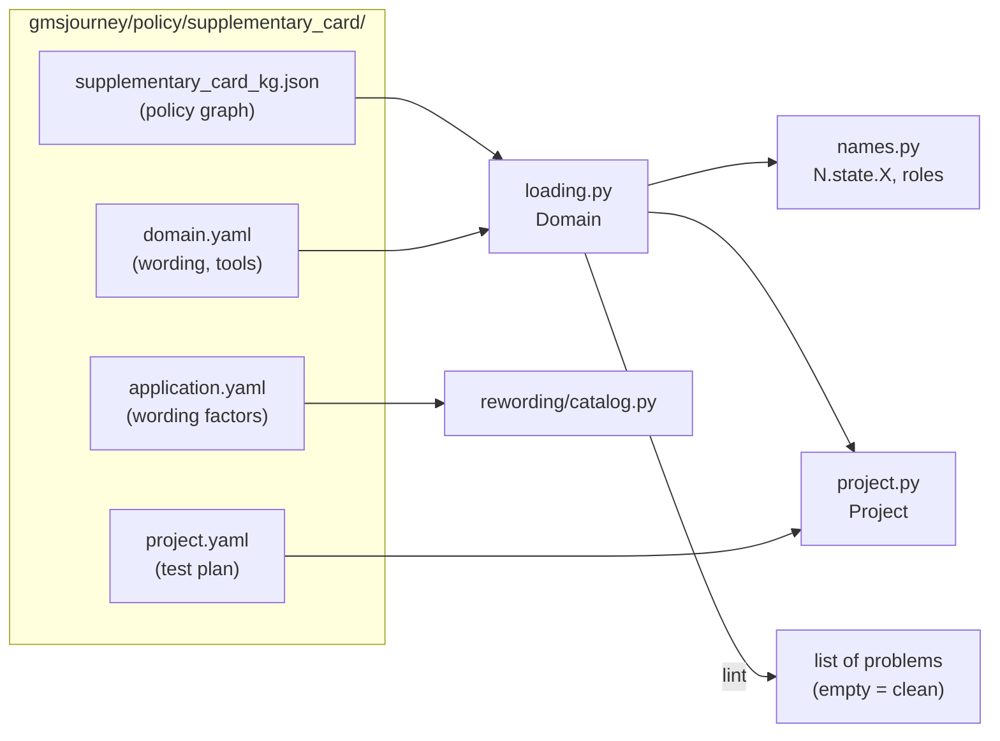

# 1. Packs: one journey's files, loaded and checked

```
voicebot/
└── gmsjourney/
    ├── packs/            ◀ this chapter
    │   ├── __init__.py
    │   ├── loading.py    load a pack, make it active, lint it
    │   ├── names.py      the graph's names (N.state.X) and tools by role
    │   ├── project.py    project.yaml: the test plan
    │   └── drafting.py   first drafts of wording and test plan
    ├── graph/  knowledge/  cases/  rewording/  bots/  checks/  campaign/  reports/  console/
    └── policy/           the packs themselves (data, chapter 11)
```

## The idea

The engine in `gmsjourney` is the same for every journey. What changes from one journey to the next lives in a
**pack**: one folder under `gmsjourney/policy/<name>/`. A pack is like a **game cartridge**: the console (the
engine) is the same, the cartridge says which game it plays.

A pack holds:

| file | says | who writes it |
|---|---|---|
| `<name>_kg.json` | the **policy graph**: the rules, limits, tools, states and transitions | built from the PDF, or written by hand as a compact graph |
| `domain.yaml` | how customers word things (the *lexicon*), how the reference bot words its lines, how the mock tools behave | by hand; for a compact graph most of it is mined from the graph, and `drafting.py` drafts the rest |
| `project.yaml` | the **test plan**: the mock bank's defaults, the simulated customer's scripts, the journey factors, scoring settings | by hand, or drafted by `drafting.py`, then edited in the studio |
| `application.yaml`, `custom_factors.yaml` | which wording factors of the catalog apply to this bot | by hand |
| `base_factors.yaml` | (compact packs) base-case factors for the older graph campaign path | drafted, then edited |

The rule that runs through the whole project: **the graph decides, the project configures, nothing else names the
domain.** Code never writes `"PRESENT_TXN"` or `"authenticate_customer"`; it asks the pack.



## loading.py — load a pack and check it

```
packs/
└── loading.py   ◀   PART 1 Domain, load, set_current, current, on_switch, lint
                     PART 2 the lint checks
```

### Part 1: `Domain`, the active pack

`load(name_or_path)` accepts a pack name (`"charge_review"`), a folder, a graph file or a config file, and returns a
`Domain`. A `Domain` knows its folder, its `domain.yaml` settings and its graph, and offers `section("lexicon")`,
`get("fixtures.credential")`, `limit_keys()`, `graph_path`, `project_path`.

For a **compact graph** (chapter 2), the sections a campaign reads (tools, figures, rules, flow, journey) are
*mined from the graph* by `graph/compact.py: derive_config`, and `domain.yaml` is laid on top with `deep_merge`
(nested dictionaries merged key by key, anything else replaced). So a compact pack's `domain.yaml` only needs the
customer wording and the bot's lines.

**The active pack.** Many parts of the code need "the current journey" (the registry of names, the store, the
project). Rather than pass it everywhere, there is one process-wide active pack:

* `set_current(pack)` makes a pack active;
* `current()` returns it (loading the default, `$GMSJOURNEY_DOMAIN` or `charge_review`, on first use);
* `on_switch(fn)` registers a reset that runs whenever the active pack changes. Every cache that belongs to a pack
  (its names, its symbolic store, its lexicon, its reference bot's bench) registers one, so switching packs never
  leaves stale data behind.

Analogy: a library with one reading desk. `set_current` puts a book on the desk; everyone reads from the desk; when
the book changes, `on_switch` tells everyone to clear their notes.

### Part 2: the lint checks

`lint(domain)` runs every registered check (`@check` adds a function `(domain, graph) -> list of problems` to
`CHECKS`) and returns all the problems found; an empty list means the pack is clean.

| check | what it verifies |
|---|---|
| `lexicon_matches_graph` | every lexicon slot is a value set of the graph, with exactly that set's members; aliasing levels and depths are consistent |
| `lexicon_round_trip` | every value phrase and act template, at every aliasing level and paraphrase depth, reads back to the meaning it was written for (the frame reader is run on the realizer's output) |
| `tools_match_graph` | every graph tool has an entry and every entry is a graph tool, with a valid role (`auth`, `read`, `write`, `handoff`) and arguments |
| `figures_match_graph` | every limit and named figure exists in the graph and has a value |
| `fixtures_match_graph` | the mock bank's fixtures use values the graph knows |
| `rules_match_graph` | every rule entry names a graph rule, a known rule kind, and tools and limits that exist |
| `no_boolean_keys` | no unquoted `yes` / `no` / `on` / `off` as a YAML key (YAML would read them as booleans) |
| `flow_matches_graph` | every state, act, rule, tool and figure the flow section names exists |
| `journey_is_consistent` | every journey dimension has a default and its levels are consistent |

`patterns_only` marks a check of a hand-written section that a compact pack mines instead, so it only checks
patterns there. From a shell: `python -m gmsjourney.packs.loading <pack>` (exit code 1 when there are problems).

## names.py — the graph's names, and tools by role

```
packs/
└── names.py   ◀   PART 1 GraphNames, N (the registry)
                   PART 2 roles: GATE, ITEMS, RECORD, OPTIONS, ACTION, TRANSFER, KEY, FEE_OPTION ...
```

### Why a registry

If code compares `state == "PRESENT_TXN"` and the graph renames the state, the comparison silently becomes false
and a check stops working without anyone noticing. So core code never spells a graph name. It asks the
**registry**:

```python
from gmsjourney.packs.names import N
N.state.PRESENT_TXN        # -> "PRESENT_TXN", read from the graph
N.state.PRESENT_TX         # AttributeError: ... did you mean PRESENT_TXN?
```

A misspelt or removed name fails loudly *where it is used*, with a suggestion. `tests/test_names.py` scans the core
modules and fails if any of them spells a graph name as a string literal.

### Part 1: `GraphNames`

`graph_names()` reads the active pack's graph once (cached per pack, reset by `on_switch`) into a `GraphNames`:
states, prompt states, the stage of each state, customer acts with their slots, which acts each prompt accepts, how
each prompt reads a bare yes or no, value sets and aliases, tools (`Tool`: stage, success and failure statuses,
what happens on failure, arguments, returned fields), rules (`Rule`: id, stance, text, the fact it states),
triggers (`Trigger`), limits, write tools, the gate tool's chain, and derived decisions such as
`question_state` (the state a policy question is asked in when nothing else is pending: the first prompt reached
once the gate tool succeeds). `Names` gives attribute access to one set of names (`N.state`, `N.act`, `N.tool`,
`N.value`, `N.limit`, `N.rule` ...).

### Part 2: roles

Some code needs "the tool that records the customer's answer" without knowing what it is called in this journey.
Roles are module attributes resolved **on every access** in the active pack's graph (through a module-level
`__getattr__`), so they follow pack switches:

| role | the tool or value that ... |
|---|---|
| `GATE` | authenticates (the tool account tools `require`) |
| `ITEMS` | returns the list of items to review |
| `RECORD` | records the customer's answer for an item |
| `OPTIONS` | returns the options the customer may choose from |
| `ACTION` | performs the chosen action |
| `TRANSFER` | hands the call to a person |
| `KEY` | the argument that identifies an item |
| `FEE_OPTION`, `FREE_OPTION` | the option that needs a fee confirmation / the free one |
| `ANSWER`, `ACT`, `OPTION`, `REASON` | the record tool's answer argument, the action tool's two arguments, the transfer reason |
| `ACCOUNT_TOOLS`, `WRITE_TOOLS` | every tool that needs authentication first / that changes the account |
| `DELIVERY`, `OK` | the delivery value set; the write tools' success status |

Analogy: in an orchestra you ask for "the first violin", not for "Maria". Whoever sits in that chair answers.

## project.py — the test plan

```
packs/
└── project.py   ◀   Level, Factor, Project, CaseView, check, derived, project(), main
```

The policy graph says what the bot must do in every situation, but not *which situations to test*. That is the
project's job. `project.yaml` holds:

* `fixture`: the mock bank's defaults (credential, items and their ages, the session date ...);
* `customer`: the simulated customer's default answers and scripts (what it says in reply to each bot act);
* `factors`: the **journey factors**. Each factor has levels; a level is a *patch* to the bank and/or the customer.
  For example, `authenticate_customer: failed_2x` patches the bank so the tool returns `[FAILED, FAILED]`;
* `constraints`: combinations of levels that are not allowed together (expressions);
* `categories` and `tags`: how cases are grouped in the reports (expressions over the case's levels);
* `generator`: settings for case building (which case a lone policy question is asked in, padding questions);
* `evaluation`: severity overrides, risk-tier promotions, release-gate profiles (chapter 7);
* `speech`: leniencies and cue words for the speech check (chapter 7).

A factor looks like this (from `supplementary_card/project.yaml`):

```yaml
- name: authenticate_customer
  about: "what authenticate_customer returns (verifies the caller ...)"
  default: ok
  anchor: {tool: authenticate_customer}     # the decision point this factor is about
  relevant_when: reached                    # relevant only if the case reaches that tool
  levels:
    ok: {}
    retry_authenticated:
      fixture: {tool:authenticate_customer: [FAILED, AUTHENTICATED]}
    failed_2x:
      fixture: {tool:authenticate_customer: [FAILED, FAILED]}
      boundary: true                        # exercises a limit exactly
    unavailable:
      fixture: {tool:authenticate_customer: [UNAVAILABLE]}
```

**Why levels are data.** A level changes only the *inputs* (what the bank returns, what the customer says). The
oracle then walks the graph against those inputs and computes what the bot must do. So adding a level needs no
code: `tests/test_project.py: test_a_new_level_needs_no_code` proves it.

The classes: `Level` (fixture patch, customer patch, and case-building hints: `boundary`, `questions`,
`turn_target`, `exact`, `transfer`, `avoid_transfer`), `Factor` (name, about, default, levels, `relevant_when`,
`role`, `anchor`), `Project` (the whole file). `CaseView` is what an expression in the file can ask about a case
(`level('noise')`, `reached('SUBMIT')`, ...). `parse_frame("ACT(slot=value)")` reads a meaning card written in the
file. `check(project, domain)` validates every name and value against the graph: an act the graph declares, slots
it allows, a status the tool can return, expressions that parse. `derived(...)` lists what the graph *suggests* as
factors, shown next to the configured ones in the studio. `project()` returns the project in use (cached;
`reset_cache()` forgets it). `fixture_keys` / `loop_fixture_keys` say which bank settings exist for a pack.

From a shell: `python -m gmsjourney.packs.project check` or `show`.

## drafting.py — first drafts from a graph

```
packs/
└── drafting.py   ◀   PART 1 draft_lexicon, fill_lexicon, draft_bot_says, fill_bot_says
                      PART 2 draft (a project.yaml), tool_about, main
```

When a compact graph arrives without a hand-written `domain.yaml` or `project.yaml` (a new journey opened in the
console, or a value added in the graph editor), `drafting.py` writes a working first version, like a builder's
template: everything in the right place, the wording plain.

### Part 1: wording

* `draft_lexicon(graph)` writes the customer lexicon: for every value, how it is said at each aliasing level
  (`canonical`, `synonym`, `colloquial`) and the cue words the reader listens for; for every act a template.
  Every phrase is chosen so that **the frame reader reads it back as the meaning it was written for** (the same
  round trip the lint runs). `fill_lexicon` only adds what is missing, so hand edits are kept.
* `draft_bot_says(graph)` writes the reference bot's line for every state that speaks. A prompt asks for what its
  acts carry; a statement says every field the graph requires, with units from the limits (`{min_age} years`) and
  optional fields in brackets (`[, the reference is {reference}]`). `fill_bot_says` fills only the missing ones.

### Part 2: the project

`draft(domain)` writes a first `project.yaml` from the graph alone:

* mock-bank defaults (the credential, every tool's success, one item for a loop);
* the customer's scripts (the happy-path answer at each prompt);
* one journey factor **per tool answer** (each success and failure status, plus `unavailable`), **per customer
  choice at a prompt** (each accepted act and value), plus a person asked for, an unclear answer, a policy
  question, turn pressure (at the limit, over it) and, for a loop, the item count (one, two, at the cap, over it),
  the window's edges and the second item answered differently;
* `tool_about` writes each tool factor's description from the graph's own text about the tool.

From a shell: `python -m gmsjourney.packs.drafting <pack> --write` (an existing file is kept as `.bak`).

## How this segment is used

* Every other segment reads the active pack through `current()`, the registry `N` and the roles.
* The console's studio edits `project.yaml` and saves it through `Project`/`check`.
* The console's "open a graph by path" uses `drafting.py` to give a new compact graph a working pack, then checks
  the drafted wording by playing every project case (`console/graphs.py: check_wording`).
