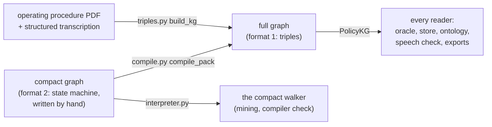
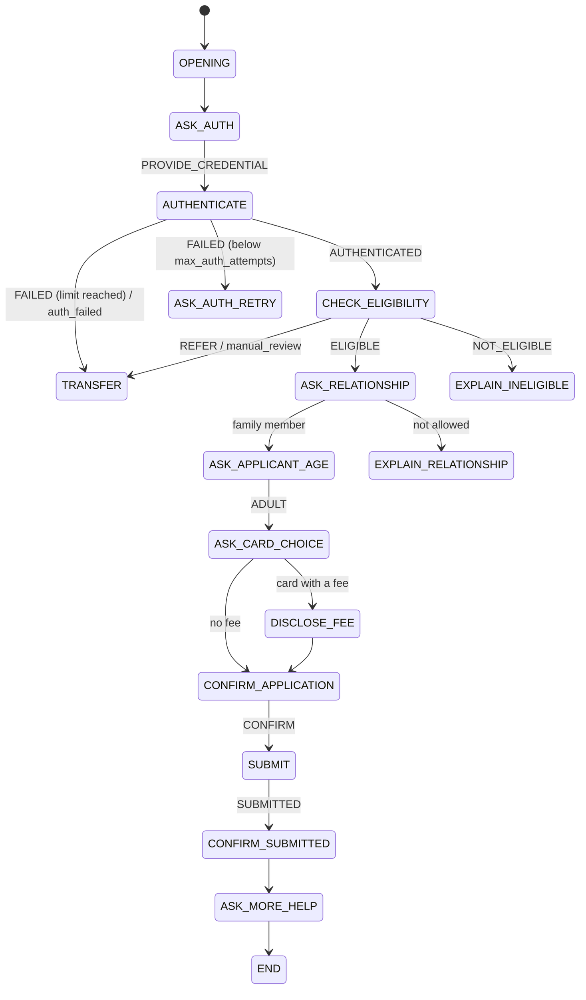
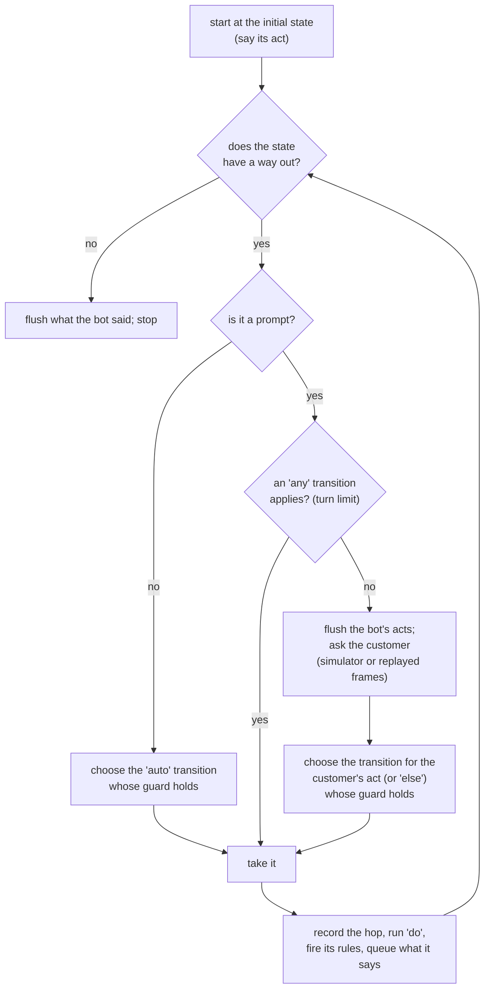

# 2. The policy graph: the policy as data, and the oracle that walks it

```
voicebot/
└── gmsjourney/
    ├── packs/
    ├── graph/              ◀ this chapter
    │   ├── __init__.py
    │   ├── triples.py      format 1: the full graph (head / relation / tail); PolicyKG
    │   ├── compact.py      format 2: the compact state machine; PolicyGraph
    │   ├── compile.py      compact graph -> full graph and symbolic store
    │   ├── flow.py         the expression language and the oracle (GraphOracle)
    │   └── interpreter.py  the compact graph's own walker
    ├── knowledge/  cases/  rewording/  bots/  checks/  campaign/  reports/  console/
    └── policy/<pack>/<pack>_kg.json   the graph files themselves
```

## The idea

Everything in this project is computed from one source: the **policy graph**. It is the operating procedure written
so precisely that a program can follow it. If you know the graph, you can say, for any conversation, what the bot
should do next.

Analogy: a **railway timetable plus the signalling rule book**. The stations are the dialog states, the tracks
between them are transitions, each signal (a condition) says which track to take, and the rule book says which rules
apply at each station. Anyone holding the timetable can tell where a train must go next; nobody needs to write the
journeys down in advance.

A graph has two layers:

| layer | contains | example |
|---|---|---|
| **policy** | facts, figures, rules, tools, value sets, aliases | `(expedited_delivery, has_fee_usd, 15)`, rule R27 "an unrecognized charge is not proof of fraud" |
| **dialog** | states, the acts each prompt accepts, transitions with conditions and actions, what each act says | `ASK_AUTH --PROVIDE_CREDENTIAL--> AUTHENTICATE` |

There are **two ways to write a graph**, and one way to read it:



## Format 1: the full graph (`triples.py`)

```
graph/
└── triples.py   ◀   PART 1 the charge-review dialog as data (Row, Act, StateSpec, rows)
                     PART 2 build_kg (PDF -> triples) and PolicyKG (load, validate, query)
```

A **triple** is one fact: `head`, `relation`, `tail`. Every triple in the file also carries:

```json
{"id": "T0027", "head": "standard_delivery", "relation": "has_fee_usd", "tail": 0,
 "tail_type": "number", "kind": "policy", "source": "pdf.5",
 "evidence": "Standard replacement delivery fee is $0.", "gms": true}
```

* `kind`: what layer it belongs to (`policy`, `state`, `trajectory`, `vocabulary`, `speech`, `flow`, `domain`);
* `source`: the PDF section it comes from (`pdf.5`), or `program` (a program limit), `lexicon`, `design` (added by
  the harness and said so);
* `evidence`: a sentence quoted **verbatim** from that section;
* `gms`: whether the knowledge store is trained on it (speech and flow triples are not);
* `qualifiers` (transitions only): the executable details, below.

Charge review's graph has 1,066 triples over 60 relations (the most common: `leads_to` 135, `has_alias` 129, `is_a`
86, `applies_rule` 79). A transition looks like:

```json
{"head": "ASK_AUTH", "relation": "leads_to", "tail": "TRANSFER",
 "qualifiers": {"on": "any", "when": "max_turns reached before the journey completes",
                "guard": "turns() >= limit('max_turns')", "do": ["set('reason', 'turn_limit')"],
                "rules": ["R28"], "discard": true}}
```

### Part 1: the dialog written as data

Charge review's dialog flow was transcribed from PDF sections 2, 3 and 7 into Python data: `Row` (one transition:
from, to, on which act, condition, evidence, rules, workflow edges, the expressions to execute), `StateSpec` (one
state: stage, whether it prompts, what it accepts, how it reads a bare yes or no, rules, limits, next tools,
triggers), `Act` (what a bot act carries in the trace), `Said` and `SpeechSpec` (what an act tells the customer and
the words that signal it). `rows()` returns every transition.

### Part 2: building and reading

`build_kg(pdf, transcription)`:

1. reads the PDF as layout-preserving text (`pdf_text`, so the tools table keeps its columns);
2. splits it into sections `pdf.1` ... `pdf.7` (`pdf_sections`);
3. for every fact of the structured transcription (`charge_review_policy.md`), finds the sentence of its section that
   shares the most content words (`best_evidence`) and quotes it;
4. adds the state layer from Part 1, the vocabulary, and the speech layer;
5. writes the JSON with a SHA-256 of its content.

`PolicyKG` is the read side used everywhere: `where(relation=..., head=...)`, `states`, `prompt_states`, `says`,
`to_markdown()` (the policy rendered back as the structured document) and `validate()`, which checks that:

* every evidence quote is a verbatim substring of its source section;
* every state is reachable from `OPENING`;
* every rule applies in some state;
* every transition and accepted act refers to a declared state and act;
* the content hash matches.

`resolve_policy(path)` accepts either the JSON graph or the markdown transcription. From a shell:
`python -m gmsjourney.graph.triples build --pdf fictional_poc_operating_procedure_gpt_readable.pdf`.

## Format 2: the compact graph (`compact.py`)

```
graph/
└── compact.py   ◀   PolicyGraph, to_triples, graph_kg, derive_config, derive_rule_checks, dump_compact
```

Writing 1,000 triples by hand is not practical for a new journey, so a journey can be written as a **compact
graph** (schema `gmsjourney.policy_graph/2`): one JSON file of about 120 lines. `supplementary_card_kg.json` is a
complete example. Its sections:

| section | holds | example |
|---|---|---|
| `limits` | every figure, with unit and text; `internal` = never told to the customer | `"max_auth_attempts": {"value": 2, "unit": "attempts"}` |
| `values` | value sets, each member with customer synonyms and attributes | `"PREMIUM_SUPP": {"aliases": ["the metal card"], "annual_fee_usd": 95}` |
| `acts` | customer acts and the value set each slot takes | `"CHOOSE_CARD": {"card_product": "card_product"}` |
| `tools` | stage, role, arguments, success and failure statuses, returned fields, what is echoed | `"ok": "SUBMITTED", "fail": ["DECLINED"]` |
| `rules` | stance, text, and optionally a machine check | `"R13": ["must", "Before submitting a card with an annual fee, state the fee ...", {"disclose_before": ...}]` |
| `transfers` | the transfer state and tool, and every reason with the rule behind it | `"auth_failed": "R4"` |
| `global` | behaviours available at every prompt: a person, a policy question, an unclear answer, the turn limit | `"unclear": {"clarify": "ASK_CLARIFY", "limit": "max_clarification_retries"}` |
| `states` | the dialog as a state machine | below |
| `knowledge` | knowledge-base sentences the bot may answer from | "The applicant must be at least 18 years old." |

The **state kinds**:

| kind | written as | meaning |
|---|---|---|
| ask | `"on": {act: target}` | the bot asks; the customer's act picks the target |
| call | `"call": tool, "on": {status: target}` | the bot calls a tool; its status picks the target (`UNAVAILABLE` = the call raised, `ECHO_MISMATCH` = success echoing another value) |
| say | `"say": {field: value}, "go": target` | the bot says something and moves on |
| each | `"each": "$tool.field", "as", "where", "cap", "do", "empty", "over_cap", "done"` | a loop over the items a tool returned; `@next` in the body moves to the next item |
| end | `"end": true` | the conversation ends |

A **target** is a state name, `!<reason>` (transfer for that reason), a list of guarded alternatives
`[{"if": {"age_band": ["MINOR"]}, "then": "EXPLAIN_AGE_LIMIT"}, "ASK_CARD_CHOICE"]`, or a counter
`{"below": "max_auth_attempts", "then": "ASK_AUTH_RETRY", "else": "!auth_failed"}`. Guards test captured slots
(`{"slot": [values]}`), attributes of captured values (`{"card_product.requires_fee_confirmation": ["yes"]}`),
membership in a returned list, or call counts. Field values `$slot`, `$slot.attr`, `$tool.field`, `$<limit>`,
`$opening` are resolved at run time; **numbers always come from exact memory**, never from text.

A small piece of supplementary card's machine:



`PolicyGraph` loads the file and offers helpers (`members(value_set)`, `kind(state)`, `prompt_states`, `loops`,
`numeric_attributes()`, `glob`, ...). `is_v2(path)` says whether a file is a compact graph. `to_triples` /
`graph_kg` expand it into the triples shape so every reader works unchanged; `rule_reification` turns a rule into
the `(subject, predicate, object)` fact it states (for the contradiction check). `derive_config` mines every
`domain.yaml` section a campaign needs (tools with roles and statuses, figures, rules, flow, journey dimensions)
and `derive_rule_checks` turns the machine-checkable rules into runtime call checks and speech checks.
`dump_compact` writes a graph back in its reading layout (one line per entry). `deep_merge` lays `domain.yaml` on
the mined config.

## compile.py — compact graph to full graph

```
graph/
└── compile.py   ◀   PART 1 compile_pack: compact -> full graph (executable flow, speech layer)
                     PART 2 compile_graph: compact -> symbolic store; render_gms_view
```

The compiler is like a **compiler of a programming language**: a short program (the compact graph) becomes the
explicit form the runtime executes (the full graph). Same meaning, more detail.

### Part 1: `compile_pack`

The compact machine becomes executable `leads_to` triples with expressions:

* **call states** become quiet steps (the bot says nothing) that call the tool and branch on its status; a success
  that echoes another value than the one requested reads as a mismatch;
* the **global behaviours** become transitions out of every prompt, in the interpreter's order of precedence: a
  request for a person, a policy question, the state's own acts, an unclear answer;
* the **turn limit** is checked before a prompt is said (`on: any` with `retract`: the prompt that was about to
  be said is withdrawn and the call transfers);
* **loops** become a quiet `loop_step` that loads and filters the items the first time, then gives the next item
  bound to the loop variable, resets the per-item counters, and branches on item / empty / over cap / done;
* what each act **carries** and what each tool is **called with** are written as expressions of the same language;
* the outcome acts, claim acts and the **speech layer** (what each act must say) are added.

The compiled flow walks every journey the compact interpreter mines **identically**: 85 journeys for supplementary
card, 276 for charge_review_graph (`tests/test_pack_compile.py` replays them all and reports "0 different").
`PackCompileError` is raised when a compact graph cannot be compiled as written.

### Part 2: `compile_graph`

The same compact graph becomes a symbolic knowledge store (chapter 3): exact figures, rules, workflow edges, value
sets and aliases, with the self-correction log. `prose_candidates` reads figures out of the knowledge sentences as a
second witness; `render_gms_view` writes the tables knowlytix's ingest trains on (`yes_no_words` handles columns the
ingest would read as pass/fail); `render_policy_markdown` renders the graph as a readable policy document;
`attribute_phrasings` writes the policy-question phrasings used to train the contradiction (u) space.

## flow.py — the expression language and the oracle

```
graph/
└── flow.py   ◀   PART 1 parse, evaluate, Transition, FlowSpec, Context, GraphOracle, Limits
                  PART 2 PolicyOracle (the name the rest of the code uses)
```

### The expression language

Transitions carry small expressions such as

```
call('record_charge_response') == 'SUCCESS'
tail(get('delivery'), 'requires_fee_confirmation') == 'yes'
turns() >= limit('max_turns')
fire('R27') if slot('intent') == 'fraud' else None
```

They are written in a **vetted subset of Python**: names, constants, tuples and lists, `and`/`or`/`not`, `+`/`-`,
comparisons, `x if c else y`, and plain calls to a fixed table of functions. Nothing else: no attribute access, no
subscripts, no keyword arguments, no builtins. `parse(expr)` walks the syntax tree and rejects any other node or
any unknown name (cached with `lru_cache`); `evaluate(expr, ctx)` runs it against a `Context` whose `f_<name>`
methods are the callable functions.

Why a vetted language rather than Python? Because the graph is data that people edit. A whitelist means a graph can
never run arbitrary code, and every name an expression uses can be checked against the graph before anything runs.

The function table (methods `f_*` of `Context`):

| group | functions |
|---|---|
| the customer's turn | `act()`, `slot(name)` |
| the call's memory | `get(name)`, `set(name, value)`, `n(name)`, `inc(name)` |
| the policy | `limit(key)`, `enm(category, key)`, `tail(head, relation)`, `member(value, set)`, `text(head)` |
| tools | `call(tool)` (call it; returns its status), `field(tool, name)`, `options(tool, name)`, `echoed(tool, *names)`, `count(tool, status)`, `select(...)` |
| lists and loops | `size`, `has_value`, `where`, `at`, `load`, `next_item`, `item`, `pending`, `overflow`, `loop_step` |
| writes and claims | `writes(tool, key, value)`, `recorded()`, `claim_recorded()`, `claim_action()` |
| bookkeeping | `fire(*rules)`, `kb_answer()`, `kb_log()`, `end()`, `turns()` |

### `FlowSpec`: the flow, read and checked

`FlowSpec.from_kg(kg)` reads every `leads_to` triple into `Transition`s (source, target, `on` act, `match`, `pre`,
`guard`, `do`, `say`, `rules`, and the turn-boundary controls `flush`, `discard`, `retract`, `quiet`), plus the
initial state, the prompt states, what each act `carries` and what each tool is called with (`has_arg`). It fails
with a `FlowError` if any state, function or act an expression names does not exist.

### `GraphOracle`: walking the flow

The oracle is the **examiner with the rule book**: given what the customer said and what the bank returned, there
is exactly one correct next move. `GraphOracle.run(spec, fixture)` plays one journey:



Taking a transition records `(source, target, act)` in the path, runs its `do` expressions (which may call tools on
the mock bank), adds its rules to `rules_fired`, and queues the acts it says. The result is a `Trace` (chapter 6):
every bot act with its fields, every customer frame, every tool call with its result, the rules fired, the flow path
taken and the outcome. **The oracle consumes meaning cards, never text**, which is what makes the invariance proof of
chapter 5 sound.

`run` takes three ways of answering prompts: the case's simulated customer (default), a fixed list of frames to
replay (`frames_override`, used by the proof to replay what was read back from reworded text), or any
`responder(last_act) -> frame`. `gateway_factory` wraps the mock bank to inject faults (chapter 6).

`Limits.from_store(store)` reads every limit the graph declares (`(key, is_a, limit)`) exactly from the store's exact
numeric memory. `PolicyOracle` is the name other modules use for `GraphOracle`.

**Parity.** The graph-driven oracle replaced a hand-written one with identical results on 86 base cases, 1,500
random cases, 2,064 faulted and 1,092 replayed runs (`tests/test_flow_parity.py` against the old oracle kept in
`tests/legacy_oracle.py`); mutating a guard in the graph changes the walk.

## interpreter.py — the compact graph's own walker

```
graph/
└── interpreter.py   ◀   GraphOracle (compact), NeedChoice
```

A second, independent walker that interprets the compact state machine directly, without compiling it:

* **say** emits the state's act (fields resolved from captured slots, the current loop item, tool results,
  attributes and exact limits) and follows `go`;
* **ask** emits the act and takes the customer's meaning card; the global behaviours apply in every ask state; else
  the act's slots are captured and its target followed;
* **call** calls the tool with resolved arguments and follows the branch for its status;
* **each** moves to the next in-scope item, up to the cap;
* **transfer** says what was truly recorded, says TRANSFER with the reason, calls the handoff tool, stops;
* **end** emits the end act and stops.

The walk is split into `advance` (from a state to the next prompt) and `react` (the customer's answer), so the same
interpreter also drives the compact reference bot one turn at a time (chapter 6). In **explore mode** it raises
`NeedChoice` whenever the script does not say what the customer does next; the journey miner (chapter 4) catches it
and branches, which is how every path through the machine is enumerated.

Why two walkers? Like checking a sum by adding the column up and then down: the compiler's output is trusted
because an independent interpreter takes the same path on every mined journey.
