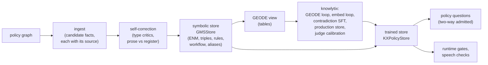
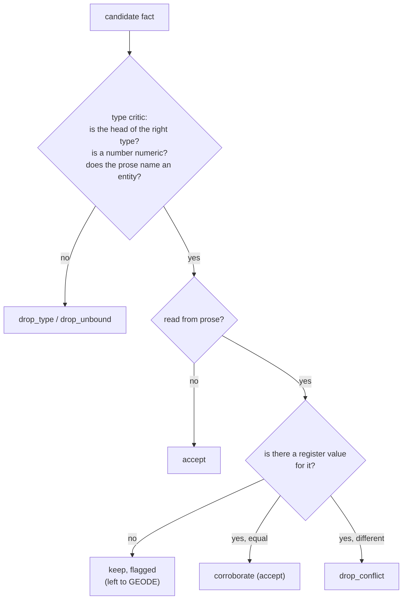

# 3. Knowledge: the store that every answer is read from

```
voicebot/
└── gmsjourney/
    ├── s01_packs/  s02_graph/
    ├── s03_knowledge/      ◀ this chapter
    │   ├── __init__.py
    │   ├── store.py        ingest, the symbolic store, canonicals, the GEODE view, the pack's store
    │   ├── build.py        self-correction, the knowlytix backend, the trained store
    │   └── questions.py    policy questions: true answers, grading, mining
    ├── s04_cases/  s05_rewording/  s06_bots/  s07_checks/  s08_campaign/  s09_reports/  s10_console/
    └── policy/
```

## The idea

Whenever any part of the project needs a policy fact ("what is the expedited fee?", "may the bot call an unrecognized
charge fraud?", "which tool may follow authentication?") it asks the **knowledge store**, called the **GMS**
(geometric memory store). Nobody types an expected answer by hand; it is always read from here.

The store has two layers, like a **bank vault next to a map**:

* **the vault** (*symbolic layer*, `store.py`): exact figures in sealed envelopes. Every authoritative number is kept
  verbatim under a key with a SHA-256 seal (*exact numeric memory*, ENM), plus the typed facts, rules, workflow,
  value sets and synonyms. When the project needs a number, it opens the vault: it never parses a number out of text.
* **the map** (*geometric layer*, `build.py`, needs the licensed `knowlytix` library): every entity is a point and
  every relation a learned rotation, so a true fact `(head, relation, tail)` lands close to where the relation
  predicts and a false one lands far away. The map answers "how plausible is this?" questions: is this tool
  transition allowed, does this sentence contradict a rule, which real option does "the express one" mean.

The vault decides numbers; the map scores plausibility and is checked against the vault.



## store.py — the symbolic store

```
s03_knowledge/
└── store.py   ◀   PART 1 ingest (Source, CandidateTriple, CandidateENM, Rule, WorkflowEdge, IngestResult)
                   PART 2 GMSStore, ENMEntry, IntegrityError
                   PART 3 export_canonicals (gms_canonicals.json)
                   PART 4 the GEODE view (render_gms_markdown, kx_relation, kx_tail, kx_triple)
                   PART 5 symbolic_store, pack_store, pack_oracle
```

### Part 1: ingest

`ingest_markdown(path)` reads charge review's structured policy document section by section: limits and fees become
exact values *and* triples, options, rules (`Rule`: id, stance `must` / `must_not` / `may`, subject-predicate-object,
text, source), workflow (`WorkflowEdge`: from, to, condition), value sets, aliases, entity types, knowledge-base
sentences and required language. Every candidate carries a `Source` (section, row id, the verbatim span), so any
fact can be traced back to its sentence.

`extract_prose_candidates` is a **deliberately naive second reading**: it pulls numbers out of the free-text
knowledge-base sentences and binds each to the nearest option name. It exists to be checked: if the prose and the
register disagree, the self-correction loop must notice (next section). `canonical_number` writes numbers in one
form (`"15"`, `"0"`, `"2.5"`).

### Part 2: `GMSStore`

The compiled store holds:

| piece | what | read with |
|---|---|---|
| **ENM** | every figure as `ENMEntry(category, key, value, unit, sha256, sources)`; the seal is `sha256("category|key|value|unit")` | `lookup_enm("limit", "max_auth_attempts")` (raises `IntegrityError` if a value no longer matches its seal) |
| triples | the admitted facts, with provenance | `query_triples(head, relation, tail)`, `tails(head, relation)`, `relation_range(relation)` |
| rules | every rule with its stance | `store.rules` |
| workflow | the allowed tool-to-tool steps | `store.workflow` |
| value sets, aliases | the members of each set and the customer's synonyms | `store.value_sets`, `store.aliases` |
| knowledge sentences | what the bot may answer from | `store.kb_sentences` |

`negatives_for(head, relation, tail)` draws plausible wrong tails (used for false claims and distractors);
`summary()` counts everything. Charge review's store holds 530 typed triples (the dialog-state layer included).

### Part 3: canonicals

`export_canonicals(store, kg)` writes `gms_canonicals.json`: every canonical value with its aliases and how the
trained store binds each alias, membership scores against the cut, tension to disjoint siblings, the exact numbers
with their seals, the states and acts, and every trained fact with its score and cut. It is tied to the graph's
SHA-256, so it can be matched to the exact graph it came from.

### Part 4: the GEODE view

knowlytix's ingest reads markdown tables: each wide table becomes typed triples `(row, has_<column>, cell)` and each
numeric cell becomes a sealed ENM entry. The source policy mixes bullet lists and multi-alias cells that the parser
would flatten, so `render_gms_markdown` re-renders the same compiled facts as **one table per relation**.
`kx_relation`, `kx_tail` and `kx_triple` translate between our vocabulary and the trained store's (for example
yes/no become `required` / `not_required`, because the ingest reads yes/no columns as pass/fail flags). Lessons
learnt fitting the parser: numeric tables must carry no other text column (it would fold into the ENM key), and
alias tables become `has_alias` edges, which are the supervision for the embedding loop.

### Part 5: the active pack's store

`symbolic_store(graph)` compiles the symbolic store straight from a policy graph in about a second (no training, no
licence); `store.kg` is the full graph. `pack_store()` caches it per pack and `pack_oracle()` is the graph oracle on
it. The console, the studio and the playground run entirely on this.

## build.py — building the store

```
s03_knowledge/
└── build.py   ◀   PART 1 build_store (self-correction), oracle_property, to_dot
                   PART 2 the knowlytix backend: available, require, describe, encoders, device
                   PART 3 build_kx_store, load_kx_store, CachedKX, KXPolicyStore
```

### Part 1: symbolic self-correction

Before anything is trained, every candidate fact is diagnosed, like a **copy editor cross-checking a manuscript
against the reference tables**:



Each decision is a `Correction(iteration, decision, fact, reason, source)`; the loop repeats until nothing changes
(convergence), then structural critics flag workflow nodes without a type and rules that reference an unknown limit.
`build_store(..., inject_misread=True)` plants an OCR-style misread (expedited fee `$150` instead of `$15`) to prove
the loop catches it: all 12 real prose figures corroborate and the misread is dropped
(`injected_misread_caught: true`). For a compact graph, `build_store` calls `s02_graph/compile.py: compile_graph`.

`oracle_property(store)` checks the store is an *oracle, not an index* (book Ch. 4): every ENM-backed fact scores
inside its relation's cut, and the same fact with a substituted tail scores outside. `to_dot` draws the store (or
some relations) in Graphviz.

### Part 2: the knowlytix backend

knowlytix-core is a compiled, licensed library; the project never ships it or a trained store.
`available()` says whether knowlytix, proofloop and forgeloop are installed and a licence is configured
(`KNOWLYTIX_LICENSE_KEY` or `~/.knowlytix/license.key`); `require()` raises a clear error otherwise; `describe()`
lists the installed versions.

Two text encoders are needed: **v** (entity names: "the express one" should land near `expedited_delivery`) and
**u** (phrasings of relations: "how much does it cost" should route to `has_fee_usd`). `resolve_encoders` picks
Hugging Face models, local folders (`local_encoders`), or an **offline stand-in** (`build_offline_encoder`): a
Hugging Face-format WordPiece tokenizer plus a one-layer BERT whose word embeddings are signed hashes of sub-words
and whose attention and feed-forward outputs are zeroed, so with mean pooling it is a deterministic
bag-of-sub-words hashing encoder. Every knowlytix step runs on it unchanged; its absolute scores are lower bounds.
`device()` picks cpu or cuda (`GMSJOURNEY_DEVICE`); `guard_deepspeed` stops a broken DeepSpeed install from
crashing torch.

### Part 3: the trained store

`build_kx_store(...)` runs knowlytix's reference pipeline with the same parameters as its
`build_calibrated_rag_store`:

1. compile the policy and render the GEODE view (ours);
2. resolve the encoders;
3. **GEODE loop** (`GeodeLoop`, 8 rounds, a 300-epoch trainer): ingest, propose, train, diagnose, correct, until
   converged. Duplicate edges are audited, not removed, by default (`kx_dedup_mode=off`), because for `enables` a step
   legitimately enables several next steps;
4. **embed loop** (`GeodeEmbedLoop`): fine-tune the v encoder on the alias table, so customer synonyms bind to their
   canonical entity (`kx_v_sft_mode`: `full`, `rotation`, or `ab` to train both and keep the better);
5. **contradiction SFT** on u (400 epochs), so a phrasing that asserts the opposite of a rule lands in tension with it;
6. relevance thresholds;
7. the **production store** (`store_from_triples` on the fact triples with the *cap loss*, which makes each relation's
   `cap_radius` the admissibility cut);
8. coverage reports;
9. **judge calibration** (`GMSJudge.calibrate`, saved as `calibration.json`);
10. a build report with every diagnostic, timing and the ENM agreement table (all 12 figures must agree byte for
    byte with the compiled register, or the build fails).
11. the trained store's **entity points** (`export_entity_points` → `gms_points.npz`: every entity's row of the
    production store's model, `entity_points`), which the console's GMS sphere draws by their angular distances
    (chapter 10). A store built before this was saved gets them the next time it is loaded.

A store is cached by the hash of the policy and settings, so later campaigns reload it in seconds
(`load_kx_store`). `store_config` assembles the production store's configuration; `KXBuild` is a store plus its
report.

**What the map is used for.** `KXPolicyStore` subclasses `GMSStore`: exact reads come from the register (cross-checked
against knowlytix's own), geometric reads from the trained store:

| read | question it answers |
|---|---|
| `score_triple(h, r, t)` | how far is this fact from where the relation predicts? A claim is grounded when `score_triple <= cap_radius(r)` |
| `cap_radius(r)` / `tau(r)` | the relation's admissibility cut |
| `tension_energy` | do two values contradict (disjoint siblings such as RECOGNIZED / UNRECOGNIZED)? |
| `check_holonomy` | does a chain of relations close (a declared composition)? |
| `stance_check` | does a sentence assert or deny a rule's fact (e.g. "this means fraud" against R27)? |

Calibration notes from the design: per relation the cut comes from the cap radius (for example 0.527 for
`has_value`); the holonomy self-test cut is fitted on the declared-composition cohort; the tension cut is taken from
the store's own same/opposite cohort when the judge's own calibration is degenerate on a small graph.

`CachedKX` memoises every geometric read (they are pure functions of a frozen store); with it a campaign over a cached
store runs in about 2.5 minutes on a CPU.

## questions.py — policy questions

```
s03_knowledge/
└── questions.py   ◀   PART 1 kb_answer (the truth), judge_kb_answer (grading)
                       PART 2 mining charge review's questions (18 categories), two_way_check, store_self_tests
                       PART 3 questions of a compact graph (kb_frames, graph_kb_answer, mine_graph_kb_items)
```

A customer may ask "how much is expedited delivery?" in the middle of a journey. This file computes the true answer,
grades the bot's answer, and generates the questions a campaign asks.

### Part 1: truth and grading

`kb_answer(store, frame)` returns a `KBTruth`: the answer, its type (`money`, `days`, `number`, `bool`, `entity`,
`set`, `bundle`, `absent`, `stance`, `procedure`), the store primitive that computed it, a **re-derivation** (a second
way to compute the same answer), an optional geometric agreement test, and the fact triples that carry the answer.

`judge_kb_answer(store, frame, answer_text)` grades a bot's answer:

* for figures, `anchored_figures` uses the speech reader (chapter 7) to tie every figure in the answer to its subject;
  every figure tied to the asked subject must equal the truth (so a correct answer is correct in any order), and a
  figure about a sibling of the asked subject is reported as *volunteered*;
* `extract_numbers` (digits, number words, "free" / "no charge" as 0) and `money_mentions` ($N, N dollars) are the
  fallbacks;
* yes/no questions read the first clear yes or no cue;
* for an **absent** truth (the policy does not say, e.g. a refund amount), the bot must abstain: the tier is
  `abstained` or `fabricated`.

The result is `{'correct': bool, 'tier': str, 'detail': str}`.

### Part 2: the 18 categories and two-way admission

Questions are generated per category of the base catalog, with every answer computed by the store:

| category | example | answer from |
|---|---|---|
| exact_recall | the fee / delivery days of each option; each limit | the register |
| fact_completion | "is the expedited fee $5, $10, $15 or $20?" (options are numeric neighbours of the truth) | the register |
| plausibility | "is expedited delivery $25?" (one true and one counterfactual claim per option), "does unrecognized mean fraud?" | register, stance |
| absence_detection | "what refund will I get?" | absence: the bot must not invent one |
| ranking | which option is faster | comparison of delivery days |
| comparative_discrimination | which option is cheaper | comparison of fees |
| counting | how many delivery options are there | the value set |
| cross_reference | which option needs a fee confirmation | the attribute |
| numeric_computation | how much more expedited costs than standard | difference of two figures |
| cross_table_aggregation | fee, time and confirmation of expedited in one question | three facts |
| multi_hop | the price of the fastest option | faster, then its fee |
| conditional_rule | can a charge from N days ago be reviewed (inside, far outside the window) | the lookback limit |
| boundary | the same at exactly the limit and one day past it | the lookback limit |
| procedural_ordering | the steps of the review | the workflow |
| governance_policy | can verification be skipped | the rules |
| contradiction, reasoning_path_consistency | not customer-facing: run as store self-tests (below) | tension, holonomy |
| recovery | handled by journeys (a failed tool), not as a question | — |

**Hallucination probes** add near-miss option names ("priority delivery", "same day delivery", "economy delivery")
and an unstated fee (securing the card): the truth is absence and the bot must abstain. The store's binding of each
fake name to a real option is reported, because a strong binding is where an embedding-driven bot would fabricate.
`mine_kb_items(store, extended=True)` adds more questions over the same facts.

**Two-way admission** (`two_way_check`): a question becomes a base case only when two independent witnesses agree,
like a bank that needs two signatures:

1. the **symbolic** re-derivation equals the answer (else `rejected`);
2. if one fact triple carries the answer, knowlytix's own generator gate (`ExactRecallGenerator(geometric=True)`)
   must also recover it: the true tail ranks first among decoys **and** sits inside the relation's cap radius.

Questions that pass both are *doubly grounded*; questions whose answer no single triple carries (a procedure, a
comparison) are *symbolic only*; a forged triple is rejected. `kx_substrate` runs knowlytix's own answer-key
generators on the store as a precondition (the graph must answer its own questions at 100%); `render_truth` writes
the graph's answer as text.

**Store self-tests** (`store_self_tests`) must pass before anything is scored, and the campaign stops if they do not:

* **contradiction**: the policy's rules contain no contradiction, and a planted reversal of a `must` rule (the same
  fact with stance `must_not`) is caught;
* **reasoning-path consistency**: every composition the facts close is certified by holonomy, and the same chain
  against an unrelated relation is not.

### Part 3: a compact graph's questions

A compiled pack has no hand-written intents, so its questions are read from its figures: `kb_frames(graph)` lists
every numeric attribute the lexicon can word (a value of a named member) and every non-internal limit;
`graph_kb_answer` reads the truth from the register; `mine_graph_kb_items` builds one base case per frame and admits
it with the same two-way check. `answer_type` says `money` for attributes ending in `_usd`, else `number`.
