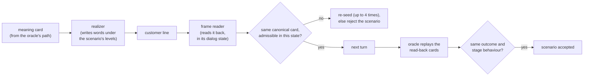

# 5. Rewording: saying the same thing in other words, with proof

```
voicebot/
└── gmsjourney/
    ├── s01_packs/  s02_graph/  s03_knowledge/  s04_cases/
    ├── s05_rewording/        ◀ this chapter
    │   ├── __init__.py
    │   ├── catalog.py        records (QAItem, Scenario, SUTResult) and the factor catalogs
    │   ├── wording.py        lexicon, surface noise, the realizer, the frame reader
    │   ├── proof.py          the invariance proof and negative controls
    │   ├── proof_cache.py    proofs reused from earlier runs when nothing they depend on changed
    │   ├── llm_arm.py        an LLM writes the turns: prompts, realizer, second reader, gates, exports
    │   ├── llm_pack.py       the LLM arm's wording for any pack
    │   ├── llm_proof.py      the LLM arm's proof; build_llm_arm
    │   └── catalogs/official/   the domain-neutral catalogs (data, chapter 11)
    ├── s06_bots/  s07_checks/  s08_campaign/  s09_reports/  s10_console/
    └── policy/<pack>/application.yaml, custom_factors.yaml   which factors apply to this bot
```

## The idea

Real callers say the same thing a hundred ways. A bot that passes only when the customer speaks like the test
author is not ready. So each base case is played many times with the customer's lines **reworded**: casual or
formal, with typos or speech-recognition errors, numbers spoken as words, a false start, an emotional aside.

But a reworded test is only fair if **the words changed and nothing else**. If rewording "no, I don't recognise it"
produced "yes, that's mine", a failure would be the test's fault, not the bot's. So every reworded scenario is
**proved** to be the same test as its base before it is used.

Analogy: a **translator and a back-translator**. One person writes the sentence in a new style; a second person, who
never saw the original, reads it back. If the back-reading equals the original meaning in every turn, and the
examiner, replaying the back-read meanings, reaches the same verdict, the rewording is accepted.



## catalog.py — records and the factor catalogs

```
s05_rewording/
└── catalog.py   ◀   PART 1 QAItem, Scenario, SUTResult
                     PART 2 BaseSpec, FactorSpec, Profile, Catalog, resolve, validate, level_provenance_table
```

### Part 1: the records passed around the campaign

* `QAItem`: one base case: its content, its ground truth, and the per-component truth (what each stage must do);
* `Scenario`: a base case under one assignment of wording levels (`sid`, `base`, `factor_levels`, `mode`);
* `SUTResult`: what a bot returned (answer, components, trajectory, status, escalation).

### Part 2: the catalogs

The **official catalog** (`catalogs/official/`, a pinned copy of proofloop's) is domain-neutral: 40 factors for any
question-answering system plus two voice factors (`disfluency`, `self_correction`), 18 base types, and profiles.
Each `FactorSpec` says its group, its levels, whether the truth stays the same under it (`gt_invariant`) and which
base families and answer types it applies to.

Each pack's **application layer** (`application.yaml`, `custom_factors.yaml`) says what applies to *this* bot, and
why, for every factor:

* **selected** (charge review: 16): `clarity`, `entity_aliasing`, `specificity`, `numeric_format`, `noise`,
  `disfluency`, `self_correction`, `paraphrase_depth`, `question_format`, `emotional_frame`, `style`, `history`,
  `instruction_conflict`, `answer_anchoring`, `confidence_pressure`, `length`, with level vocabularies for a voice
  channel (`noise: [none, typo, asr]`, `numeric_format: [digits, spoken]` ...);
* **excluded**, each with a reason (e.g. `context_format`: a voice bot has no document context);
* **moved to the base**, because they change the correct behaviour: `tool_availability` (a failed tool requires a
  transfer), `clarity.Ambiguous` (an ambiguous answer requires a clarification), `intent_count`, `edge_case`.

Two decisions matter most: `clarity=Ambiguous` lives in the base (it changes what the bot must do), and `history` is
realised as an in-turn preamble, never as an extra turn, because an extra turn changes the turn count and can flip
the 20-turn outcome (the `insert_turn` negative control shows the proof catching exactly that).

`Catalog.load()` reads the official catalog and the active pack's layer; `resolve(catalog, bases, factors, mode)`
returns a `ResolvedSuite` (the bases and factors a run uses, with every dropped factor and its reason);
`resolve_profile` does it for a named `Profile` (`voice_full`, `quick_screen`); `validate` enforces the catalog
contract (`validate_official`: the five rules of proofloop's validator plus profile references;
`validate_application`: every factor selected, excluded or moved, nothing unknown or twice);
`level_provenance_table` maps each application level to the catalog level it realises.

## wording.py — writing and reading customer lines

```
s05_rewording/
└── wording.py   ◀   PART 1 Lexicon (cap, low, fill, cue_regex)
                     PART 2 surface noise (typo, asr_noise, disfluency)
                     PART 3 Realizer (number_to_words, spell_digits)
                     PART 4 FrameReader
```

### Part 1: the lexicon

`Lexicon.current()` reads the pack's `domain.yaml → lexicon` once per pack: for every value, how it is said at each
aliasing level (`canonical`, `synonym`, `colloquial`) and its cue words; for every act, its templates at each
paraphrase depth; the wrappers (asides, emotional frames); the words that are **protected** from noise. It is the one
source for both writer and reader, but the reader uses it differently (cues and patterns, not templates), which is
what keeps the two independent.

### Part 2: surface noise

* `typo`: keyboard-style typos (swap, drop, neighbouring key) inside words of 5+ letters;
* `asr_noise`: speech-recognition confusions (homophones, lowercasing);
* `disfluency`: fillers between words ("um", "you know") or a restarted phrase.

Decision-critical tokens (negations, yes/no, digits, protected words) are never touched.

### Part 3: the realizer

`Realizer.realize(frame, levels, seed, context)` writes a line in **three layers**, like dressing a mannequin:

1. **core decision**: the act's template with the slot values worded at the scenario's aliasing level and numbers in
   the scenario's format (`numeric_format=spoken`: `number_to_words(15)` → "fifteen dollars"; credentials digit by
   digit with `spell_digits`);
2. **meaning-neutral wrappers**: politeness, an emotional frame, a history preamble, a confidence-pressure aside,
   style and length;
3. **surface noise**: typos, ASR errors, disfluencies.

It is deterministic for a given seed (`random.Random(seed)`), so a re-run produces the same words. An act's template at
a depth may be a list of variants (the confused customer, `UNCLEAR`, has four ways to say it at `light` and four at
`deep`); one is picked per case from its seed, so a run hears confusion said many ways while the original wording
(`none`) stays one fixed line.

### Part 4: the frame reader

`FrameReader.read(text, state)` reads a line back into a meaning card, **in the dialog state it answers**:

1. split into clauses; acts that win outright (`reading.first`, e.g. a request for a person) are tried first;
2. a code (a 4-digit credential) is read as such only where the state asks for one; elsewhere other cues win and a
   number is a code only if nothing else was said;
3. then, in order: a question clause as a policy question (an intent ladder from the most specific cue to the most
   general: refund, fraud, skipping verification, the procedure, a window check with a day count ... fee and time
   questions last); **confusion about the question** (`reading.before_values`: an act's `strong_cues`, such as "what
   do you mean", "not sure what you're asking", "that makes no sense", "you lost me", "can you rephrase"), so "not
   sure what you mean" is not read as the answer UNSURE; a decision (e.g. a disposition, with any card request
   attached); a request on its own; an end or plainer confusion (`reading.then`: "I don't understand", "I don't
   know", "huh"), after any real answer so "not mine, I don't understand why it's there" stays an answer; the latest
   confirm-or-deny cue; otherwise UNCLEAR. Curly apostrophes are read as plain ones.

It implements **policy rules**, not the realizer's templates:

* value words bind through the store's alias edges;
* typos are repaired by edit distance to the ontology's vocabulary, never "repairing" valid English words;
* numbers in words are read as digits;
* reported speech ("my wife said it's not ours") is handled;
* **the latest clear answer wins**, and an earlier different answer is recorded as a correction only when a repair
  marker sits between them ("no, sorry, yes" is a correction; "no thanks, that's all" is not).

How a bare yes or no is read in a state is left to the ontology (`Ontology.canonicalize`), so the same words can mean
different things in different states without the reader knowing the journey.

## proof.py — the invariance proof

```
s05_rewording/
└── proof.py   ◀   PART 1 surface similarity (normalize_text, HashingEncoder, surface_cosine)
                   PART 2 InvarianceValidator (gt_hash, ProofResult)
                   PART 3 GraphInvarianceValidator (any compact-graph pack)
```

**Claim.** For every reworded scenario s′ of base s: the expected outcome and the per-stage expected behaviour of s′
equal those of s.

**Argument.** The oracle's output is a function of (meaning-card sequence, fixture) only. The fixture is shared by
construction. So it suffices to show the card sequence read back from s′'s words equals s's, turn by turn.

The four layers, all checked per scenario:

| layer | checks | gating? |
|---|---|---|
| **L1** truth identity | the truth the scenario carries equals the truth recomputed from scratch (by content hash, `gt_hash`) | yes |
| **L2** card equivalence | every reworded turn, read back by the frame reader in its state, is the same canonical card as the base turn and admissible there; so the conversation's signature equals the base signature | yes |
| **L3** oracle re-derivation | the oracle replays the **read-back** cards; outcome and every stage component must equal the base answer | yes |
| **L4** geometric corroboration | how far the words moved (surface cosine) and how far the meaning moved (graded distance, always 0 when accepted) | reported only |

A turn failing L2 is re-realised with a fresh seed (up to 4 times) and the seed is pinned for the run; a scenario that
still fails is rejected and excluded, as GEODE discards questions it cannot vouch for. `ProofResult` records every
layer, the signatures, turns and retries.

**Negative controls: proving the proof has teeth.** A checker that accepts everything would also "pass". So
`negative_controls` makes deliberate **meaning-changing** edits and requires the proof to reject them. The edit kinds
include: confirm ↔ deny, swapping a disposition, a card action or a delivery option, adding or dropping a card
request, changing a credential digit, swapping a policy question's attribute, entity or limit, end → request a
person, raw-text edits (a negation, a digit, a figure, a merchant, a bare yes/no), **`wrong_state`** (the same words
answered in a state that does not accept that meaning) and **`insert_turn`** (an extra turn). Charge review: 592 edits
across 17 kinds, 100% rejected. Raw-text edits are made only where unambiguous (exactly one cue of the edited kind).

**Surface similarity** (Part 1). `HashingEncoder` is a signed feature-hashing encoder with a numeric block;
`surface_cosine(a, b)` says how different two wordings are (1.0 = same words). It is reported next to the proof to
show the rewording really moved the words.

`GraphInvarianceValidator` (Part 3) is the same proof for a compact pack, with the base path taken from the graph
oracle's own walk of the case.

## proof_cache.py — reusing proofs from earlier runs

A proof depends only on the case (its spec, mock-bank fixture, answer key and the rewording's factor levels), the
journey's own files (graph, domain lexicons, project) and the code that words, reads and replays it. `ProofCache`
files every proof under exactly those (`<GMSJOURNEY_CACHE>/proofs/<context>/<case>.json`: the context hashes the
validator, the journey's files and the source of the packs, graph, knowledge, cases and rewording stages; the file
name hashes the case), with what the proof set on the scenario (`seed_overrides`, `proof`), and the frames stored as
act and slots so they come back equal. With `CampaignConfig.reuse_proofs` (the run page's *Reuse meaning proofs from
earlier runs*, on by default in the console) step 5 takes a filed proof instead of proving the case again; any change
to the case, the journey or that code misses the cache and the case is proved afresh (and refiled). Proofs are always
filed, so the next run can reuse them; `report.json` → `invariance.cache` says how many were reused.

Reused proofs are byte-for-byte the proofs a fresh run computes (the reference runs compare equal). The template arm's
proofs are quick (768 cases of `supplementary_card` in about 10 s), so the saving grows with the size of the design;
the LLM arm's rewordings come back from the LLM replay cache already and are proved again each run.

**What the proof does not cover.** It certifies the customer's *meaning*. Whether a given bot understands that
meaning is exactly what the test measures.

## The LLM arm: llm_arm.py, llm_pack.py, llm_proof.py

```
s05_rewording/
├── llm_arm.py     ◀   PART 1 prompts   PART 2 LLMRealizer   PART 3 LLMFrameExtractor
│                      PART 4 LLMOutputGates   PART 5 CSV exports
├── llm_pack.py    ◀   the prompts' wording and the reader's schema for any compiled pack
└── llm_proof.py   ◀   PART 1 LLMInvarianceValidator   PART 2 build_llm_arm
```

Templates cannot produce the open-ended variety of real callers; a language model can. But an LLM is an **untrusted
writer**: it can drop a value, add a figure, answer its own question, hedge a decision, or leak internal names. So the
LLM arm has its own, stricter proof.

**Blind generation** (`build_rephrase_prompt`). The prompt holds only: the agent's question in that state
(`state_question`), the meaning in plain words (`describe_meaning`), the base wording, the factor instructions
(`factor_instructions`), the tokens to keep verbatim (`protected_tokens`), the words the rule reader understands, and
feedback from a failed attempt. **Never** the expected outcome, the oracle or the policy figures.

**Per-turn gates** (`LLMOutputGates`), every LLM line must pass all of them:

| gate | on | rejects |
|---|---|---|
| G0 form | raw text | empty, too long, speaker labels, stage directions, several lines, tool or act names, rule ids, tool statuses |
| G1 facts | raw text | a figure or merchant not licensed by the base wording, the template wording or the card; a dropped decision value |
| G3 one clear decision | final text | more decision cues than the requested presentation allows (only a self-correction may carry two) |
| G2 meaning | final text | the rule reader's card in the state differs from the base card or is not admissible there |
| G2′ dual read | final text | (`dual_read="gate"`) an independent LLM reader (`LLMFrameExtractor`), blind to the base, recovers a different card |

A rejected line is regenerated with feedback; after `max_attempts` the turn falls back to the template wording for
that turn, proved the template way (`turn_fallback="template"`), so one hard turn does not sink the whole
conversation. Some acts can keep the template wording outright (`template_acts`, e.g. policy questions).

**Instrument power on LLM text.** The deterministic meaning-changing edits are applied to accepted LLM lines; and an
**adversary** LLM (`build_adversary_prompt`) is asked to change exactly one meaning element. An accepted adversarial
rewrite is either a gate miss or a rewrite that kept the meaning; the audit list lets a person decide.

**Reader coverage, not a weakness.** An LLM line the rule reader cannot read is rejected (a false reject) and
regenerated. So the acceptance rate measures how well the reader covers what the LLM writes; it can never let a
changed meaning through.

**Attribution on realised levels.** A factor counts as realised when it is detected on at least half the turns it
applies to; otherwise the scenario is attributed at the base level, so a failure is never blamed on a factor the bot
never received.

**Reproducibility.** Completions are cached by the hash of (prompt version, model, temperature, messages, salt), the
salt being the scenario seed, so a re-run with `--llm-mode replay` uses no network (chapter 12, `llm.py`).

`llm_pack.py` reads the arm's wording from any compiled pack (the bot's prompt wording from `domain.yaml → bot.says`,
value names from the lexicon, the reader's schema from the graph's acts and value sets: `act_schema`,
`extraction_schema`, `kb_intents_text`, `gates_one_decision`). `build_llm_arm` wires one cached client per role
(rephrase, extract, adversary) so roles never share completions. `write_llm_exports` writes the arm's CSV files
(chapter 11).
