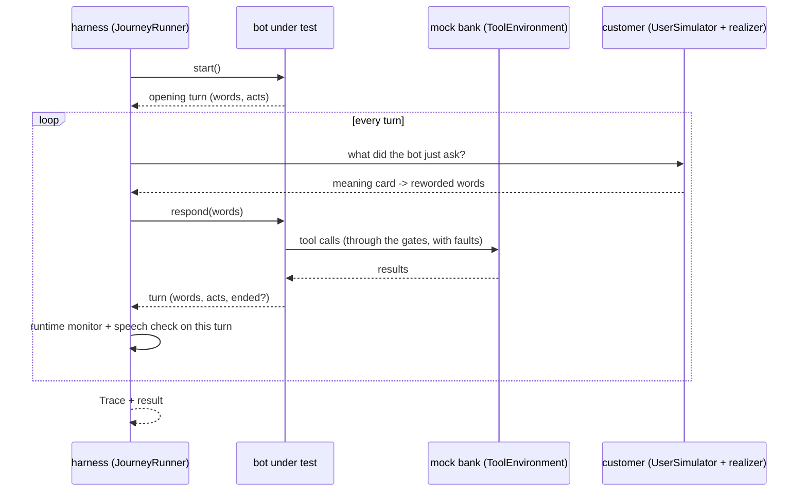

# 6. Bots: the systems under test, the mock bank, and the harness

```
voicebot/
└── gmsjourney/
    ├── s01_packs/  s02_graph/  s03_knowledge/  s04_cases/  s05_rewording/
    ├── s06_bots/         ◀ this chapter
    │   ├── __init__.py
    │   ├── tools.py      the mock bank, fault injection, the Trace of a run
    │   ├── reference.py  the reference bots and their planted defects (mutants)
    │   ├── llm_bot.py    an LLM bot (gateway or local model) with a critique layer
    │   └── harness.py    plays a case against any bot; adapters for your own bot
    ├── s07_checks/  s08_campaign/  s09_reports/  s10_console/
    └── policy/
```

## The idea

A test needs three actors: the **bot** being tested, the **backend** it calls (here a mock bank), and the
**customer** (the simulator of chapter 4). The harness puts them in a room and records everything.

Analogy: a **flight simulator**. The pilot (the bot) flies; the simulator provides the instruments and the weather
(the mock bank, with faults on demand); the instructor's recorder logs every input and every reading (the trace);
afterwards the examiner (chapter 7) compares the recording with the rule book.



## tools.py — the mock bank and the trace

```
s06_bots/
└── tools.py   ◀   PART 1 ToolEnvironment, ToolGateway, FaultProfile, ToolError, ToolTimeout, tool specs
                   PART 2 Trace, new_trace
```

### Part 1: the mock bank

`ToolEnvironment(fixture)` serves every tool of the active pack from the case's fixture, by each tool's declared
behaviour (`tool_specs()`, from `domain.yaml → tools` or mined from a compact graph): a status per call (a list in the
fixture is consumed one call at a time, so `[FAILED, AUTHENTICATED]` fails once then succeeds), returned fields
(the list of charges with merchant, amount, date and age), and echoes (a write returns the values it recorded, so a
bot can check the bank did what it asked). Every call is logged with its arguments and result.

Helpers find tools by role: `tools_with_role`, `account_tools` (callable only after the auth tool succeeded),
`write_tools` (change the account), `key_args` (the arguments that identify a call when comparing two runs).

**Faults.** `ToolGateway(env, profiles)` intercepts every call and applies `FaultProfile`s:

| kind | effect |
|---|---|
| `error` | the call raises `ToolError` (a service error) |
| `timeout` | the call raises `ToolTimeout` |
| `stale` | the call returns the previous call's data |
| `plausible_wrong` | the call returns a believable but wrong answer (e.g. a SUCCESS that echoes another value) |

`tool_pattern` selects tools (`*`, a name), `error_rate` how often. Faults are used by the resilience probe and by
mutation analysis (chapter 7).

### Part 2: the trace

`Trace` is **one record format for both the oracle (expected) and the bot (observed)**, so they can be compared field
by field: `events` (every bot turn with its acts, every customer turn with its card and state), `tool_log`,
`user_frames`, `presented` (items presented), `claims_recorded` and `claims_actions` (what the bot *said* it did),
`kb` (policy questions and answers), `turns`, `ended`, `rules_fired`, `notes`, `flow_path` (oracle only). It
computes the outcome (end state, transfer reason, what was **truly** recorded: SUCCESS with a matching echo, which
action truly completed) and per-stage components. `new_trace()` returns the right kind for the active pack (the
graph-generic `GraphTrace` of `s07_checks/scoring.py` for a compiled pack).

## reference.py — the reference bots and their mutants

```
s06_bots/
└── reference.py   ◀   PART 1 ReferenceBot (charge review): KeywordNLU, KBAnswerer, BotTurn, spoken_date
                       PART 2 GraphBot (any compact graph), KeywordReader, mutants, make_graph_factory
```

A **reference bot** is a stand-in for your bot, built to follow the policy and to understand customers **by keywords
only** (no paraphrase repair, like a typical intent classifier). It serves two purposes:

1. **validating the suite**: a correct bot should pass the original-wording cases; if it does not, the test is wrong;
2. **mutation analysis**: with one deliberate defect planted at a time, it shows whether the suite catches real
   mistakes.

Because it reads keywords only, it fails many *reworded* cases by design: that is the realistic weakness the
rewording is meant to expose.

`BotTurn` is what any bot returns for a turn: the words, the dialog acts (labels with fields), and whether it ended.

### Part 1: charge review's bot

`ReferenceBot` = `KeywordNLU` (lower-case keyword lists, no repair) + `KBAnswerer` (answers a policy question with the
knowledge-base sentence that shares most words with it, a deliberately narrow retriever) + the procedure as code.
`spoken_date` reads a date out ("March 13"). Its 21 planted defects (`MUTANTS`), each a realistic bug:

| defect | what it does wrong |
|---|---|
| `limit_off_by_one` | reviews up to 5 transactions instead of 4 |
| `window_off_by_one` | excludes a transaction exactly 30 days old |
| `present_all_returned` | ignores the 30-day window |
| `auth_three_tries` | allows a third authentication attempt |
| `claim_before_success` | says a response was recorded when the write failed |
| `silent_tool_failure` | carries on after a card-tool error |
| `no_echo_check` | trusts a SUCCESS whose echo does not match |
| `unsure_no_transfer` | records UNSURE and keeps going |
| `card_erases_review` | skips the remaining transactions after a card action |
| `expedited_no_disclosure` | submits expedited delivery without disclosing the fee |
| `first_answer_wins` | ignores corrections |
| `no_turn_limit` | never enforces the 20-turn limit |
| `ignore_human_mid_review` | treats a request for a person as noise |
| `guess_on_ambiguity` | assumes RECOGNIZED when an answer is unclear |
| `fraud_claim` | tells the customer an unrecognized charge means fraud |
| `kb_first_amount` | answers fee questions with the first dollar amount in the knowledge base |
| `kb_fabricate_unknown` | answers questions about options the policy does not list with real figures |
| `says_wrong_fee` | labels the fee correctly but *says* $25 |
| `misstates_recorded_answer` | records the right answer but *says* the opposite |
| `names_wrong_amount` | presents the right charge but *reads* an amount one dollar off |
| `summary_omits` | summarises only the first recorded response |

The last four change **only the words**: their tool calls and act labels are exactly the reference bot's, so only the
speech check (chapter 7) can catch them.

### Part 2: any compact graph's bot

`GraphBot` drives the compact interpreter (chapter 2) one turn at a time, reading the customer with
`KeywordReader` (the pack's lexicon cues) and speaking the pack's `bot.says` lines. `mutants(graph)` derives **every
defect the graph makes possible**, so a new journey gets mutation analysis for free:

| family | for each ... | defect |
|---|---|---|
| `status_as_ok:<tool>` | tool with a failure status | treats a failure as success |
| `ignore_echo:<tool>` | tool that echoes | trusts a mismatched echo |
| `skip_say:<state>` | say state | does not say it |
| `skip_ask:<state>` | confirmation prompt | does not ask |
| `ignore_guard:<state>` | guarded branch | takes the default branch regardless |
| `limit_plus_one:<limit>` | limit | allows one more |
| `wrong_field:<act>.<field>` | result the bot must report | reports the wrong value |

`make_graph_factory(mutant=None)` returns a bot factory for the active pack.

## llm_bot.py — an LLM bot under test

```
s06_bots/
└── llm_bot.py   ◀   PART 1 LocalChat (a local model on vLLM), status, local_model_path
                     PART 2 LLMBot, make_llm_factory, the prompt, the critique layer
```

A second system under test: a language model given the procedure, the tools and the dialog acts.

**The prompt** (`build_system_prompt`) has three parts:

1. **instructions** a tester may rewrite (`suggested_instructions`: who the bot is, how it must behave, and the
   operating procedure, `default_policy_text`);
2. **references** the tester attached (`references_text`; the console extracts text from PDFs, Word, Excel ...);
3. the **fixed protocol** (`protocol_text`) the harness needs: the tools, the transfer reasons
   (`transfer_reasons`), the dialog acts with their fields (`act_inventory`, read from the active graph), and the
   reply format.

**One JSON step per model call.** At each step the model replies with exactly one object:

```
{"tool": "<tool name>", "args": {...}}       call one backend tool (it then sees the result)
{"say": [<act>, ...], "end": false}         speak and wait for the customer
{"say": [<act>, ...], "end": true}          speak and finish (after TRANSFER or END)
```

Malformed replies and tool errors are counted (`LLMBotStats`). **The critique layer** (`make_llm_factory(...,
critique=True)`) adds a second call that reviews every proposed step against the bot's own instructions
(`critic_system`) and approves it or returns a corrected one; `critic_llm=` lets the reviewer be another model.
Replies are cached like every LLM call (`llm.py`), so repeated runs of the same conversation cost nothing.

**Where the model runs.** Through the model gateway (`llm.py`), or locally with `LocalChat(path, url=...)`: a chat
model loaded with vLLM in the process from a folder the tester types in the console (default `GMSJOURNEY_SUT_LOCAL_MODEL`),
or through an OpenAI-compatible vLLM server (default `GMSJOURNEY_VLLM_URL`). `status(path, url)` checks either without
loading anything.
`status()` tells the console whether the local model can be used without loading it. `fake_model` loads a scripted
stand-in (`GMSJOURNEY_SUT_FAKE_MODEL=module:Class`) for tests and demos without a network.

## harness.py — playing a case

```
s06_bots/
└── harness.py   ◀   PART 1 JourneyRunner, BotActClassifier, CallableBotAdapter, HTTPBotAdapter, make_reference_factory
                     PART 2 GraphRunner
```

`JourneyRunner(store, realizer, reader, bot_factory, governance=...)` runs one scenario:

1. a **fresh bot and a fresh mock bank** per scenario (never a shared stateful bot: results must not depend on the
   order scenarios run in);
2. the customer simulator chooses each answer; the realizer writes it under the scenario's levels (the pinned,
   proved wording);
3. the bot's tool calls go to the mock bank, optionally through the fault gateway and the runtime gates (chapter 7);
4. every bot turn is checked as it happens (runtime monitor, speech check, budgets);
5. the result and its `Trace` are returned.

**Testing your own bot.** Two adapters make any bot a system under test:

* `CallableBotAdapter(start, respond)`: provide two Python callables that return text (and, optionally, acts);
* `HTTPBotAdapter(url)`: a deployed bot over HTTP, `POST {session, text} -> {text, acts?, ended?}`.

For a bot that returns only text, `BotActClassifier` infers the dialog acts of each turn from cues and content, so it
is graded the same way. `item_index` gives the realizer the context of the items a tool returned (merchant names
etc.). `make_reference_factory(mutant=None)` builds the charge-review reference bot.

`GraphRunner` (Part 2) is the same loop for journeys mined from a compact graph.
