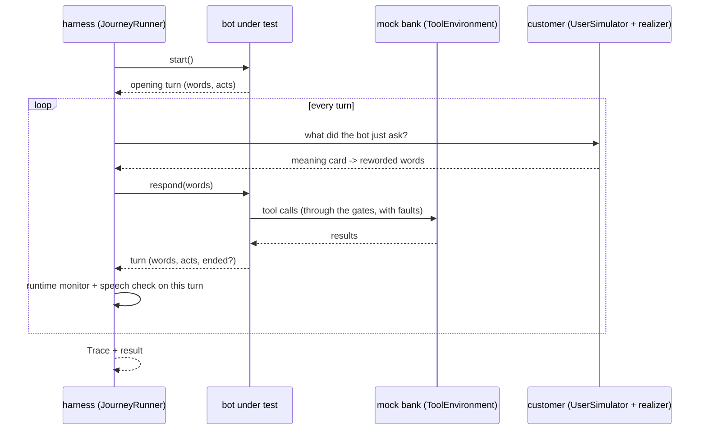
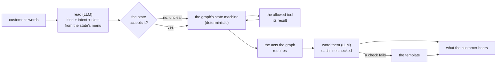

# 6. Bots: the systems under test, the mock bank, and the harness

```
voicebot/
└── gmsjourney/
    ├── s01_packs/  s02_graph/  s03_knowledge/  s04_cases/  s05_rewording/
    ├── s06_bots/         ◀ this chapter
    │   ├── __init__.py
    │   ├── tools.py      the mock bank, fault injection, the Trace of a run
    │   ├── reference.py  the reference bots and their planted defects (mutants)
    │   ├── llm_bot.py    the LLM bot: a model reads and words, the graph decides
    │   └── harness.py    plays a case against any bot; adapters for your own bot
    ├── s07_checks/  s08_campaign/  s09_reports/  s10_console/
    └── policy/
```

## The idea

A test needs three actors: the **bot** being tested, the **backend** it calls (here a mock bank), and the
**customer** (the simulator of chapter 4). The harness puts them in a room and records everything.

Analogy: a **flight simulator**. The pilot (the bot) flies; the simulator provides the instruments and the weather
(the mock bank, with faults on demand); the instructor's recorder logs every input and every reading (the trace);
afterwards the examiner (chapter 7) compares the recording with the rule book.



## tools.py — the mock bank and the trace

```
s06_bots/
└── tools.py   ◀   PART 1 ToolEnvironment, ToolGateway, FaultProfile, ToolError, ToolTimeout, tool specs
                   PART 2 Trace, new_trace
```

### Part 1: the mock bank

`ToolEnvironment(fixture)` serves every tool of the active pack from the case's fixture, by each tool's declared
behaviour (`tool_specs()`, from `domain.yaml → tools` or mined from a compact graph): a status per call (a list in the
fixture is consumed one call at a time, so `[FAILED, AUTHENTICATED]` fails once then succeeds), returned fields
(the list of charges with merchant, amount, date and age), and echoes (a write returns the values it recorded, so a
bot can check the bank did what it asked). Every call is logged with its arguments and result.

Helpers find tools by role: `tools_with_role`, `account_tools` (callable only after the auth tool succeeded),
`write_tools` (change the account), `key_args` (the arguments that identify a call when comparing two runs).

**Faults.** `ToolGateway(env, profiles)` intercepts every call and applies `FaultProfile`s:

| kind | effect |
|---|---|
| `error` | the call raises `ToolError` (a service error) |
| `timeout` | the call raises `ToolTimeout` |
| `stale` | the call returns the previous call's data |
| `plausible_wrong` | the call returns a believable but wrong answer (e.g. a SUCCESS that echoes another value) |

`tool_pattern` selects tools (`*`, a name), `error_rate` how often. Faults are used by the resilience probe and by
mutation analysis (chapter 7).

### Part 2: the trace

`Trace` is **one record format for both the oracle (expected) and the bot (observed)**, so they can be compared field
by field: `events` (every bot turn with its acts, every customer turn with its card and state), `tool_log`,
`user_frames`, `presented` (items presented), `claims_recorded` and `claims_actions` (what the bot *said* it did),
`kb` (policy questions and answers), `turns`, `ended`, `rules_fired`, `notes`, `flow_path` (oracle only). It
computes the outcome (end state, transfer reason, what was **truly** recorded: SUCCESS with a matching echo, which
action truly completed) and per-stage components. `new_trace()` returns the right kind for the active pack (the
graph-generic `GraphTrace` of `s07_checks/scoring.py` for a compiled pack).

## reference.py — the reference bots and their mutants

```
s06_bots/
└── reference.py   ◀   PART 1 ReferenceBot (charge review): KeywordNLU, KBAnswerer, BotTurn, spoken_date
                       PART 2 GraphBot (any compact graph), KeywordReader, mutants, make_graph_factory
```

A **reference bot** is a stand-in for your bot, built to follow the policy and to understand customers **by keywords
only** (no paraphrase repair, like a typical intent classifier). It serves two purposes:

1. **validating the suite**: a correct bot should pass the original-wording cases; if it does not, the test is wrong;
2. **mutation analysis**: with one deliberate defect planted at a time, it shows whether the suite catches real
   mistakes.

Because it reads keywords only, it fails many *reworded* cases by design: that is the realistic weakness the
rewording is meant to expose.

`BotTurn` is what any bot returns for a turn: the words, the dialog acts (labels with fields), and whether it ended.

### Part 1: charge review's bot

`ReferenceBot` = `KeywordNLU` (lower-case keyword lists, no repair) + `KBAnswerer` (answers a policy question with the
knowledge-base sentence that shares most words with it, a deliberately narrow retriever) + the procedure as code.
`spoken_date` reads a date out ("March 13"). Its 21 planted defects (`MUTANTS`), each a realistic bug:

| defect | what it does wrong |
|---|---|
| `limit_off_by_one` | reviews up to 5 transactions instead of 4 |
| `window_off_by_one` | excludes a transaction exactly 30 days old |
| `present_all_returned` | ignores the 30-day window |
| `auth_three_tries` | allows a third authentication attempt |
| `claim_before_success` | says a response was recorded when the write failed |
| `silent_tool_failure` | carries on after a card-tool error |
| `no_echo_check` | trusts a SUCCESS whose echo does not match |
| `unsure_no_transfer` | records UNSURE and keeps going |
| `card_erases_review` | skips the remaining transactions after a card action |
| `expedited_no_disclosure` | submits expedited delivery without disclosing the fee |
| `first_answer_wins` | ignores corrections |
| `no_turn_limit` | never enforces the 20-turn limit |
| `ignore_human_mid_review` | treats a request for a person as noise |
| `guess_on_ambiguity` | assumes RECOGNIZED when an answer is unclear |
| `fraud_claim` | tells the customer an unrecognized charge means fraud |
| `kb_first_amount` | answers fee questions with the first dollar amount in the knowledge base |
| `kb_fabricate_unknown` | answers questions about options the policy does not list with real figures |
| `says_wrong_fee` | labels the fee correctly but *says* $25 |
| `misstates_recorded_answer` | records the right answer but *says* the opposite |
| `names_wrong_amount` | presents the right charge but *reads* an amount one dollar off |
| `summary_omits` | summarises only the first recorded response |

The last four change **only the words**: their tool calls and act labels are exactly the reference bot's, so only the
speech check (chapter 7) can catch them.

### Part 2: any compact graph's bot

`GraphBot` drives the compact interpreter (chapter 2) one turn at a time, reading the customer with
`KeywordReader` (the pack's lexicon cues) and speaking the pack's `bot.says` lines. `mutants(graph)` derives **every
defect the graph makes possible**, so a new journey gets mutation analysis for free:

| family | for each ... | defect |
|---|---|---|
| `status_as_ok:<tool>` | tool with a failure status | treats a failure as success |
| `ignore_echo:<tool>` | tool that echoes | trusts a mismatched echo |
| `skip_say:<state>` | say state | does not say it |
| `skip_ask:<state>` | confirmation prompt | does not ask |
| `ignore_guard:<state>` | guarded branch | takes the default branch regardless |
| `limit_plus_one:<limit>` | limit | allows one more |
| `wrong_field:<act>.<field>` | result the bot must report | reports the wrong value |

`make_graph_factory(mutant=None)` returns a bot factory for the active pack.

## llm_bot.py — the LLM bot under test

```
s06_bots/
└── llm_bot.py   ◀   PART 1 LocalChat (a local model on vLLM), status, local_model_path
                     PART 2 StructuredBot, LLMReader, Wording, make_structured_factory
```

A second system under test, built so that a language model does only the two jobs a model is needed for: reading
what the customer means, and putting what the bot must say into words. Everything in between is the journey's policy
graph, run by the same interpreter as the reference bot (`GraphBot`, with no planted defects).



Analogy: a court interpreter and a clerk with the rule book. The interpreter (the reading model) only says what the
person meant, choosing from the forms the clerk can accept at this step; the clerk (the graph) decides what happens
and what must be said; a second interpreter (the wording model) says it back in plain words, and a proofreader
checks that every figure and name on the form made it into the words and nothing was added.

**Reading a turn** (`LLMReader`). The reading model gets a small prompt (`READ_SYSTEM`, no policy in it) and, as JSON,
the bot's last words, the customer's words and the **menu** of the current state (`menu(state)`): the intents the
state accepts with their slots and values (each value with its lexicon wording), what a plain yes or no means there,
and the policy facts a question can be about (every figure and every public limit of the graph). It answers with a
kind:

| kind | what it means | what the bot does |
|---|---|---|
| actionable | an answer the state accepts, a request for a person, the end | the graph's transition |
| question | a policy question about a figure or limit the graph states | the graph's answer: exactly the fact asked |
| claim | the customer states a policy fact ("the fee is waived, right?") | answered from the graph: "Actually, ..." when the customer's figure is wrong, never agreed to as said |
| social | small talk, thanks, an apology | nothing changes and no policy is said; the pending question is asked again |
| unclear | nothing the state accepts | the graph's clarification |

A reading is used only when the state accepts it (`frame`): an intent the state does not take, a value outside the
slot's value set (an alias is mapped to its member), or a code that is not in the customer's words (spoken digits are
read) makes the turn unclear, and the rejection is counted with why (`StructuredStats.notes`). So the model can be
wrong about meaning, which the tests are there to find, but it cannot make the bot do something the policy does not
allow at that step.

**Wording a turn** (`Wording`). The acts the graph decided, with their facts and the template line of each
(`domain.yaml bot.says`), go to the wording model in one call (`WORD_SYSTEM`), with the tester's *voice* (tone only).
Each line it returns is checked against its template (`check`): the same figures (number words read), every fact the
template says, no option the template does not name, and no promise or policy word (`speech_policy.markers`) the
template does not have. A line that fails is replaced by its template; a short acknowledgement before the first line
(`lead`) is allowed after small talk and checked the same way. With no wording model the templates are said.

**Cost.** One reading call (200 output tokens reserved) and at most one wording call (400) per customer turn, each
well under 2,000 tokens; the policy never goes into a prompt. `make_structured_factory(store, reader_llm,
wording_llm, voice)` builds it; one `StructuredStats` covers every conversation of the factory, and a factory built
before its knowledge store (a test run's) gets the store from the pipeline.
Replies are cached like every LLM call (`llm.py`), so repeated runs of the same conversation cost nothing.

**Where the model runs.** Through the model gateway (`llm.py`), or locally with `LocalChat(path, url=...)`: a chat
model loaded with vLLM in the process from a folder the tester types in the console (default `GMSJOURNEY_SUT_LOCAL_MODEL`),
or through an OpenAI-compatible vLLM server (default `GMSJOURNEY_VLLM_URL`). `status(path, url)` checks either without
loading anything.
`status()` tells the console whether the local model can be used without loading it. `fake_model` loads a scripted
stand-in (`GMSJOURNEY_SUT_FAKE_MODEL=module:Class`) for tests and demos without a network.

## harness.py — playing a case

```
s06_bots/
└── harness.py   ◀   PART 1 JourneyRunner, BotActClassifier, CallableBotAdapter, HTTPBotAdapter, make_reference_factory
                     PART 2 GraphRunner
```

`JourneyRunner(store, realizer, reader, bot_factory, governance=...)` runs one scenario:

1. a **fresh bot and a fresh mock bank** per scenario (never a shared stateful bot: results must not depend on the
   order scenarios run in);
2. the customer says its lines; the realizer writes each under the scenario's levels (the pinned, proved wording).
   Who chooses the lines is `customer`:
   * `"scripted"` (what a test run uses, `CampaignConfig.customer`): the **base journey's** lines, in order, whatever
     the bot answers. `paths` (the invariance validator) gives them: `base_path` and `base_states`, the customer lines
     of the graph's own conversation of the case and the state each one answers. A bot that goes wrong at turn 3 still
     hears turn 4 of the base case, so the case it is graded on is the case that was designed and proved, not one the
     bot steered into. Each bot turn is compared with the graph's turn for the same line (`turns.compare_turn`,
     `extras["turn_status"]`, one entry per customer turn):

     | status | what the bot did | what happens next |
     |---|---|---|
     | `same` | the graph's tool calls and acts | the next line |
     | `side` (*immaterial deviation*) | the graph's trajectory; only a policy answer (ANSWER_KB) or a clarification (ASK_CLARIFY) differs, the graph's `globals.question.answer` / `globals.unclear.clarify`, including a clarification in place of a policy answer | the turn is flagged, the next line follows |
     | `asked_again` | no tool call, and it asks again the question the customer just answered (and the trajectory differs) | the customer says the same line again (once per line); a material deviation |
     | `differs` (*material deviation*) | another tool call, another argument, or another act | the next line: the bot may get back on the journey |

     **Two material deviations in a row** (`differs` or `asked_again`), or **a material deviation that ends the call**
     (the bot hangs up or transfers where the graph does not), end the run there: the customer stops and
     `extras["stopped"]` says at which turn and line and why (`None`: the base journey was played to the end). A
     stopped run is incorrect (`c_journey = 0` in its score), whatever its outcome. One material deviation followed by
     a turn back on the journey is reported and the run goes on. A wrong policy answer on a turn that is otherwise on
     the journey is flagged at that turn (the report's `kb_wrong`); it fails the case only when the case is that
     policy question. With faults injected, or without the graph's expected turns (no validator), every line is said
     in order and nothing is stopped;
   * `"adaptive"`: the customer simulator answers the bot's last act (chapter 4), so after a bot mistake it answers
     what the bot actually asked. Useful to explore a bot, not to grade one against a fixed case.

   The result's `extras["customer"]` records which one played.
3. the bot's tool calls go to the mock bank, optionally through the fault gateway and the runtime gates (chapter 7);
4. every bot turn is checked as it happens (runtime monitor, speech check, budgets). Every bot event in the trace
   carries `at`: for each act, how many tool calls had been made when it was decided (the bot's
   `BotTurn.calls_before`; the graph's own runs record it with `s02_graph/pending.py`), so a turn is shown in the
   order it happened: *calls record_charge_response, says CONFIRM_RECORDED, calls get_card_action_options, says
   INFORM_NO_CARD_ACTION*. `turns.split_turns(events)` cuts a trace into turns with these ordered `steps`;
5. the result and its `Trace` are returned.

**Testing your own bot.** Two adapters make any bot a system under test:

* `CallableBotAdapter(start, respond)`: provide two Python callables that return text (and, optionally, acts);
* `HTTPBotAdapter(url)`: a deployed bot over HTTP, `POST {session, text} -> {text, acts?, ended?}`.

For a bot that returns only text, `BotActClassifier` infers the dialog acts of each turn from cues and content, so it
is graded the same way. `item_index` gives the realizer the context of the items a tool returned (merchant names
etc.). `make_reference_factory(mutant=None)` builds the charge-review reference bot.

`GraphRunner` (Part 2) is the same loop for journeys mined from a compact graph.
