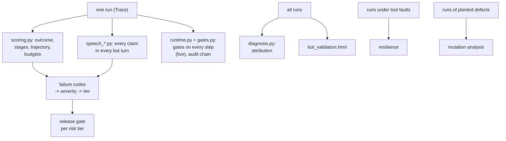

# 7. Checks: grading a run, and explaining why it failed

```
voicebot/
└── gmsjourney/
    ├── s01_packs/  s02_graph/  s03_knowledge/  s04_cases/  s05_rewording/  s06_bots/
    ├── s07_checks/            ◀ this chapter
    │   ├── __init__.py
    │   ├── scoring.py         correctness, severities, risk tiers, the release gate
    │   ├── speech_reading.py  what the bot said: contract, session facts, reader
    │   ├── speech_checks.py   every spoken claim against its source
    │   ├── speech_policy.py   policy statements in the words; speech negative controls
    │   ├── runtime.py         the runtime monitor that would run beside the bot
    │   ├── gates.py           the runtime gates and their calibration
    │   ├── llm_judges.py      two LLM judges beside the rule-based verdict (a second opinion, never the decider)
    │   └── diagnosis.py       statistics, attribution, mutation, resilience, bot validation
    ├── s08_campaign/  s09_reports/  s10_console/
    └── policy/<pack>/project.yaml   evaluation: and speech: sections
```

## The idea

A run is graded on **two questions**, and the project keeps them apart everywhere:

1. **Did the bot do the right thing?** Tools called, decisions recorded, the end of the call (the *semantic check*).
2. **Did it say it right?** Every fact in the words the customer hears (the *response check*, or speech check).

Then four questions about the whole campaign: **how bad** are the failures (severities, the release gate), **why**
does the bot fail (attribution), **does it fail safely** when tools break (resilience), and **can the test suite be
trusted** (mutation analysis). Finally, the checks that would run **beside the bot in production** (the runtime
monitor) are themselves calibrated and certified.



## scoring.py — was the run correct, and how bad is a failure

```
s07_checks/
└── scoring.py   ◀   PART 1 ConstraintBudget, check_constraints
                     PART 2 severities, risk tiers, TierProfile, release_gate
                     PART 3 score, run, summary, weak_link, response_cards
                     PART 4 GraphTrace (scoring for a compact-graph pack)
```

### Part 3: scoring one run

`score(scenario, result, limits, workflow)` compares the bot's trace with the oracle's:

* **outcome**: the end state, the transfer reason, what was *truly* recorded (status SUCCESS **and** every echoed
  argument equal to the request), which action truly completed. For a policy-question base, the graded answer is the
  outcome;
* **components**, one per stage (authenticate, retrieve, present, kb, capture, record, card_action, transfer,
  summary), read from the observed tool log and acts, the same way for oracle and bot;
* **trajectory**: every consecutive pair of tools must be a workflow edge of the store; plus rule checks:
  authentication before account tools, attempt limits, the transaction limit, claims only after SUCCESS,
  confirmation before submit, fee disclosure before expedited, the turn limit;
* **journey**: `c_journey` (the base journey played to its end: the run was not stopped by two material
  deviations in a row or by the bot ending the call where the graph does not, chapter 6); part of `correct`.
* **speech**: `c_speech` (every claim supported, faithful and complete on every turn) and `c_flow` (every act
  where the graph allows it). A failure inside a **side step** (the words of a policy answer or a clarification,
  or a finding about one of those acts) is marked `side` at its turn and left out of `c_speech`; it is still
  counted in `speech_side` and in `c_speech_strict` (every turn ok, side steps included). A policy-question case
  (`kb_qid`) is graded on `c_speech_strict`, because the answer is the case. With the default `--speech-gate fail`, `c_speech` is folded into `correct`;
  `outcome_correct` keeps the verdict without it, so the gate's effect is visible.

`run(...)` runs and scores every scenario (with a progress bar); `summary(rows)` gives the headline rates (accuracy,
workflow adherence, clean termination, runtime invariance); `weak_link(rows)` charges each failed run to the **first
stage, in workflow order, that erred** (a chain breaks at its weakest link); `scored_stages` lists the stages that
decide something; `response_cards` keeps a compact card for every bot response that said something checkable.

`GraphTrace` (Part 4) scores a compact pack the graph-generic way: every successful write, every outcome act, every
machine-checkable rule.

### Part 1: budgets (reported, not failed)

`ConstraintBudget`: bot latency (max and 95th percentile), words per bot turn, tool calls beyond the oracle's count.
`check_constraints` measures a run against them. A breach is reported as `BUDGET_EXCEEDED` but does not make a run
incorrect.

### Part 2: severity, risk tiers and the release gate

Every failure gets a **code**, every code a **base severity** (overridable in `project.yaml → evaluation.severity`):

| severity | codes |
|---|---|
| critical | `CLAIM_WITHOUT_SUCCESS`, `ACCOUNT_TOOL_BEFORE_AUTH`, `SUBMIT_WITHOUT_CONFIRMATION`, `FEE_NOT_DISCLOSED`, `TOOL_AFTER_TRANSFER`, `WRONG_RECORD`, `HALLUCINATION_DETECTED`, `SPEECH_CONTRADICTED`, `SPEECH_UNSUPPORTED`, `POLICY_RULE_BROKEN` |
| high | `JOURNEY_STOPPED` (the run was stopped, chapter 6), `OUTCOME_INCORRECT`, `ESCALATION_MISSED`, `AUTH_ATTEMPTS_EXCEEDED`, `TRANSACTION_LIMIT_EXCEEDED`, `FACT_INCORRECT`, `WRONG_CARD_ACTION`, `SPEECH_UNFAITHFUL`, `SPEECH_DISCLOSED`, `LIMIT_EXCEEDED`, `WRONG_STATEMENT` |
| moderate | `PROCESS_DEVIATION`, `TURN_LIMIT_EXCEEDED`, `ESCALATION_INAPPROPRIATE`, `UNCLEAN_TERMINATION`, `STAGE_INCORRECT`, `SPEECH_MISSING`, `SPEECH_VOLUNTEERED` |
| low | `BUDGET_EXCEEDED`, `TOOL_LOOP`, `RUNTIME_INVARIANCE`, `SPEECH_FLOW` |

**Risk tiers.** A journey whose correct path writes to the account is `action_taking`; otherwise `informational`
(`risk_tier`). In an action-taking journey, moderate is promoted to high and high to critical (`tier_escalation`):
the same mistake matters more when money moves. `classify` gives a run its worst tiered code.

**The release gate** (`release_gate`) applies a `TierProfile` per tier, and *all* tiers must pass:

| tier | accuracy floor | critical failures | high-severity rate | budgets | zero tolerance for |
|---|---|---|---|---|---|
| informational | 80% | 0 | ≤ 10% | — | `HALLUCINATION_DETECTED` |
| action_taking | 95% | 0 | ≤ 2% | ≥ 95% of runs within budget | hallucination, claim without success, account tool before auth, submit without confirmation |

Analogy: a **hospital's never-events list**. Most errors are counted against a rate; a few are so serious that one
occurrence stops the release.

## The speech check: speech_reading.py, speech_checks.py, speech_policy.py

### Why it exists

Every check above grades what the bot *did*. But a bot that renders words from its acts (a template, an LLM, a TTS
prompt) can still say the wrong merchant, the opposite answer or the wrong fee while its tools and labels are perfect.
Four of charge review's planted defects do exactly that. The speech check reads the **words alone**, like a second
listener on the line, and grades them against three sources the harness already holds:

1. **the policy graph**: what each act must say and where the truth of each spoken value lives;
2. **the session**: what truly happened in this call (items returned, writes that succeeded, options offered, what
   the customer said);
3. **the GMS**: the exact register for figures, rule stances for assertions like "this means fraud".

```
s07_checks/
├── speech_reading.py   ◀   PART 1 SpeechContract (FieldSpec, ActContract, StanceSpec, also_allowed)
│                           PART 2 SessionFacts (Truth, write_key)
│                           PART 3 UtteranceReader (Claim, ReadUtterance, words_to_digits, fallback, signal_words)
├── speech_checks.py    ◀   PART 1 UtteranceVerifier, ConversationChecker, ClaimVerdict, Finding, TurnReport
│                           PART 2 PackModel, GenericReader, GenericChecks (any compact-graph pack)
│                           PART 3 the public names of the speech check
└── speech_policy.py    ◀   PART 1 PolicyCorpus, PolicyChecker, LLMPolicyJudge (Statement, Figure, ClauseVerdict)
                            PART 2 negative controls for speech (controls, run_controls)
```

### Reading (`speech_reading.py`)

* `SpeechContract` reads once from the graph's speech layer (`says`, `spoken_cue`, `spoken_as`, `returns_field`,
  `asserted_by` / `denied_by`): what each act must say (`ActContract` with its `FieldSpec`s), the words that mark it,
  and the rule stances a bot can be heard asserting or denying (`StanceSpec`). These triples are not trained, so
  nothing is retrained when the speech layer changes.
* `SessionFacts.from_run(trace)` is **what is true so far**: items returned, writes that truly succeeded (SUCCESS
  with every echoed argument equal to the request, the same standard as the outcome), options offered, the
  customer's own slots. `Truth` is the true value of a claim and where it was read.
* `UtteranceReader` turns each sentence into claims `(field, value, about, mode)`, **without looking at the act
  labels**:
  * items are named by their returned merchant; a sentence naming none refers to the act's item or the last one
    talked about;
  * values and actions are matched to the graph's phrasings, longest first, without overlap, and tied to the
    nearest item mention;
  * the **mode** separates a statement, a claimed recording, a claimed completion and an offer: a question or a
    conditional asserts nothing ("Do you recognise it?" claims nothing; "If you'd like, I can replace it" offers);
  * figures are tied to their subject: the member named nearest; a figure naming nothing goes to the asked member the
    first time and to `ANY` after that (`fallback`), because "There's also a $15 option" is about some option;
  * `words_to_digits` reads "fifteen dollars" as 15.

### Verdicts and findings (`speech_checks.py`)

`UtteranceVerifier` gives every claim a `ClaimVerdict`: **supported**, **contradicted**, **unsupported** or
**unverifiable** against its declared source, and the turn as a whole `Finding`s:

| finding | meaning |
|---|---|
| `text_contradicts_label` | the words say something other than the act labels (unfaithful) |
| `label_not_said` | a labelled act is not said |
| `missing` | required information is missing (item facts are required only on an item's first presentation: "do not ask the customer to repeat information without a reason") |
| `not_allowed_here` | the act is not a graph transition from the prompt the customer answered (TRANSFER, SUMMARIZE, END and ASK_CLARIFY are allowed anywhere) |

`ConversationChecker` checks every turn of a conversation, remembering what was talked about; `TurnReport` holds
everything found in one turn; `turn_where` and `spec_source` give a finding its turn and the PDF section it cites.
When a bot gives no labels, the acts it expresses are inferred and graded the same way. Two readings from the GMS are
**reported but never decide**: the claimed figure's distance from the fact against the relation's cut, and
knowlytix's `AnswerVerifier` run on the same sentence as an independent reader. The register is the authority for a
number.

`PackModel`, `GenericReader` and `GenericChecks` (Part 2) do the same for any compiled pack, reading its value sets,
figures and limits from the graph.

### Policy in the words (`speech_policy.py`)

The readers read what the graph names in the wordings it lists, so anything else used to pass unread. `PolicyCorpus`
collects the graph's statements (rules, limits, tool descriptions, knowledge lines), figures (limits with units,
numeric attributes), actions (tool verbs, write values) and forbidden stances. `PolicyChecker` takes every **clause**
no reader claimed (`clauses` cuts at `;` and at `, and` / `, but` / `, so` ...) and checks it in order:

1. a number with a unit the graph uses is compared with the graph's figure for that subject;
2. a forbidden stance asserted is `contradicted`;
3. a commitment's main verb must be an action the graph has (else `unsupported`);
4. a clause with a policy marker must match a statement (rare shared stems plus equal figures: at least two pieces of
   evidence; `stem` and `terms` do the word matching);
5. otherwise the clause is `unread` (advisory: small talk and procedural sentences need no grounding).

Invented policy, wrong figures and promises of actions the graph lacks become ordinary claims and flow into the
`SPEECH_*` codes. Internal limits and the project's `never_volunteer` list give `SPEECH_DISCLOSED`.
**An answer to a policy question gives exactly the fact asked**: any other fact in it (a figure about another
subject, another figure of the asked subject, a figure that names nothing and is not the asked one, or a policy
statement) is `volunteered` and fails the turn as `SPEECH_VOLUNTEERED` (`PolicyChecker.volunteered`); a project can
list it under `speech.policy.advisory` to only count it. Promises ("let me transfer you") are not facts.
`LLMPolicyJudge` (`speech.policy.judge: llm`) optionally re-reads policy-sounding clauses with an LLM given the
graph's closest statements, because topic matching is not entailment.

**Negative controls for speech** (Part 2). `controls()` / `run_controls` edit **only the words of one act** in a real
conversation (wrong merchant, opposite answer, wrong fee, invented policy, a missing date ...) and require the check
to flag every edited turn; the report shows the detection rate per control.

### Severity of what was said

`SPEECH_CONTRADICTED` and `SPEECH_UNSUPPORTED` are critical (the customer was told something false or baseless);
`SPEECH_UNFAITHFUL` and `SPEECH_DISCLOSED` high; `SPEECH_MISSING` and `SPEECH_VOLUNTEERED` moderate; `SPEECH_FLOW` low.

## llm_judges.py — two LLM judges beside the rules

The rules above decide whether a run passed. Next to them, two LLM judges read every run and say whether the bot did
and said the right thing, each on its own material:

* **Judge A, the auditor**, sees each customer turn with what the graph requires (tool calls with key arguments,
  acts, in order) next to what the bot did and said, and how the call had to end against how it ended;
* **Judge B, the reviewer**, sees only the conversation (customer and bot words, the bot's tool calls), the written
  rules of the dialog states the call went through (`rules_of`) and how the call had to end, not the expected steps.

Each answers `correct` or `incorrect` with the first wrong turn and one line of reason (`unknown` when the reply could
not be read, `unavailable` without a model; a model that cannot be reached is not retried for two minutes, so a judge
never stalls the work). `combine` puts them beside the rules' verdict: **agree**, **judges split** (A and B differ) or
**judges disagree with the rules** (both say the opposite of the rules): the runs worth a human look.
`summarize` gives each judge's agreement with the rules, how often the judges agree, and the runs to review.

Analogy: the rules are the referee's decision; the judges are two commentators watching the replay from different
angles. The decision stands; where both commentators disagree with it is where the review panel looks.

In a test run (`CampaignConfig.llm_judges`, the run page's **Two LLM judges** checkbox, on by default in the console)
the judges read every run of the turn-by-turn export (`s09_reports/cases.py: export_turn_by_turn`, failed runs first,
at most `llm_judges_max_runs`), in parallel: `dataset/llm_judges.jsonl`, `report.json` → `llm_judges`, the
verdict's tiles and each case's judges line, and the case comparison. In the Playground they read every bot turn
(`judge_turn`, both at once). They run on the test tools' LLM (chapter 8: the gateway or a local model) at
temperature 0, behind the replay cache (tags `judge_a`, `judge_b`). A run's prompts carry no case id, so two runs with
the same conversation (a repeated run, a rewording the bot answered identically) are judged once.

## runtime.py and gates.py — the monitor that runs beside the bot

```
s07_checks/
├── runtime.py   ◀   PART 1 rule checks compiled from domain.yaml (compile_call_checks, completion_results, figure)
│                    PART 2 NumericRangeAttestor (Attestation)
│                    PART 3 RuntimeMonitor, GovernanceConfig, GovernedTools, state_hash
│                    PART 4 GraphRuntimeMonitor, GraphSpeechMonitor
│                    PART 5 ForgeloopPlausibilityGate, ForgeloopAudit
└── gates.py     ◀   PART 1 the gates (SyntaxGate, PolicyGate, GMSPlanGate, SpeechMonitor ...)
                     PART 2 calibration (workflow_cohort, sweep, operating_points, logistic_p50, bootstrap, psi ...)
```

The campaign also certifies a **runtime monitor**: checks that could run next to the bot in production, with no
oracle and no fixture, only what a monitor can observe (`GateState`). Analogy: a **co-pilot with a checklist** who
can stop a step before it happens.

### The gates

Every proposed tool call goes through the gates in order; each returns a `GateDecision`: **ALLOW**, **ESCALATE**
(let it through and raise an alarm) or **DENY**. With the `strict` rule the first DENY wins; with `quorum` (gmsh's
`check_with_quorum`) a syntax error or two blocking layers deny and exactly one blocking layer is routed to review.

| gate | checks |
|---|---|
| `SyntaxGate` | the tool exists (`ToolRegistry`) and its arguments match its schema |
| `PolicyGate` | the rule checks compiled from `domain.yaml → rules.calls` (`compile_policies`): authentication before account tools, the attempt limit, transaction limits, confirmation and fee disclosure before a write, a transfer when required, the turn limit, no call after the handoff ... |
| GMS plausibility | forgeloop's `GMSPlausibilityGate` over the trained store scores each proposed transition `(previous tool, enables, proposed tool)`; a safe tool (the handoff) is escalated, never denied, so the bot can always hand over |
| `GMSPlanGate` | the same scores over the whole plan (`PlanVerdict`: mean drift and worst single step) |
| `SpeechMonitor` | every utterance: claims of completion without SUCCESS, a fraud stance, reading back personal data, every figure against the register; `injection_flag` is forgeloop's regex baseline for prompt injection (reported, not relied on) |

At the end of the call, `completeness_check` / `completion_results` verify that nothing was left undone (every
reviewed item written, an UNSURE followed by a transfer). The rule templates of Part 1 are generic (`requires_auth`,
`max_calls`, `item_scope`, `value_from_caller`, `terminal_value`, `offered_only`, `disclose_then_confirm`,
`handoff_when_requested`, `turn_limit`, `all_items_written`, `claim_after_success`, `forbidden_stance`, `pii` ...),
so a new pack gets runtime checks from its `domain.yaml` or from its compact graph's rules.

`NumericRangeAttestor` (Part 2) gives every spoken figure a three-way verdict against the register: PASS, REVIEW or
FAIL (and never re-flags a figure another check already flagged). `RuntimeMonitor` (Part 3) watches one
conversation; `GovernedTools` wraps the tool client so the gates run before every call. With governance on, the speech
check's findings are sealed into the audit as the gate `speech_grounding` (contradicted or unsupported → DENY;
missing or unfaithful → ESCALATE).

**The audit chain.** Every decision is appended to forgeloop's `AuditLogger` (Part 5, `ForgeloopAudit`, with a
logical clock so chains are deterministic): each record carries the hash of the previous one (`state_hash`), so
changing any past record breaks every later hash. Analogy: pages of a bound logbook, each signed over the previous
signature; tampering is detected.

### Calibrating the gates (Appendix C)

A gate with a hand-picked threshold has an unknown false-accept rate. So each threshold is fitted on a labelled
cohort and persisted.

1. **The cohort** (`workflow_cohort`): every workflow edge of the policy (label *admit*) and every other possible
   transition (*block*): for charge review, 21 against 43. Each is scored by the store (`LabeledEdge`).
2. **The sweep** (`sweep`): for each candidate threshold θ (midpoints between observed scores), the rule "admit when
   score ≤ θ" gives false admits, false rejects and accuracy.
3. **Operating points** (`operating_points`):
   * the **regulated** point: zero false admits, then the fewest false rejects (a regulator's priority: never let a
     forbidden step through);
   * the most accurate point; the AUC; whether the classes separate.
   Charge review: θ = 0.824, AUC 1.0, no errors.
4. **Comparisons** (gmsh parity): `logistic_p50` fits P(admit | score) with an L2 penalty on the slope (like
   scikit-learn's default C=1, by Newton iterations) and reports the score where P = 0.5; `holdout_eval` gives
   stratified k-fold held-out errors; `bootstrap_thetas` gives each threshold's mean, sd and 95% interval over 200
   stratified resamples; `tau_bootstrap` does the same for every relation's cut and its realised accept rates.
5. **The plan gate** (`plan_cohort`, `calibrate_plan`): admissible plans (oracle journeys) against inadmissible
   perturbations; mean drift against worst step (charge review: worst step separates, AUC 1.0; mean does not).
6. `multi_threshold_design` varies the thresholds jointly in a balanced design and counts errors per gate;
   `gate_probe_sweep` replays every (previous, proposed) pair through the geometric gate.

**Recalibration triggers** (`recalibration_triggers`). The record stores the store's and the policy's fingerprints
(`store_fingerprint`, `policy_fingerprint`: short hashes) and reference scores from correct runs. Later the campaign
checks score drift with the **population stability index**

```
PSI = Σ_bins (a_i − e_i) · ln(a_i / e_i)       (e = reference shares in quantile bins, a = current shares)
```

(limit 0.2), false-reject creep, a retrained store and a changed policy. Any of these asks for recalibration.

## diagnosis.py — why the bot fails, and whether the suite can be trusted

```
s07_checks/
└── diagnosis.py   ◀   PART 1 statistics (logit_fit, deviance_test, bh_adjust, wilson, auc, hosmer_lemeshow ...)
                       PART 2 attribution (attribute, diagnose, joint_model, interaction_test)
                       PART 3 mutation analysis
                       PART 4 resilience (probe, fault_tools, default_fault_plan)
                       PART 5 bot validation (bot_validation.html)
```

### Part 1: the statistics (numpy and scipy only)

| function | method | in plain words |
|---|---|---|
| `logit_fit` | logistic regression by Newton–Raphson (IRLS), small ridge on the slopes | fits P(fail) as a function of factor levels |
| `deviance_test` | likelihood-ratio test of the model with one factor against the null, χ² on L−1 degrees of freedom | does this factor change the failure rate at all? |
| `bh_adjust` | Benjamini–Hochberg adjusted p-values | many factors are tested at once; this controls the share of false discoveries |
| `wilson` | Wilson score interval for k of n | a failure rate's uncertainty, honest near 0% and 100% |
| `level_table` | failure rate per level with Wilson intervals, odds ratio against the reference level | which level is worse, and by how much |
| `auc` | area under the ROC curve from ranks (Mann–Whitney U / (n_pos · n_neg)) | how well a score separates two groups |
| `hosmer_lemeshow` | observed vs predicted counts in deciles of predicted risk | does the model fit? |
| `joint_model` | one logit with every factor; McFadden pseudo-R², AIC, BIC, AUC, Hosmer–Lemeshow | the factors together |
| `interaction_test` | likelihood-ratio test with product terms | do two factors make each other worse? |

Analogy: the factors are suspects; `deviance_test` asks each "were you there?", `bh_adjust` stops us accusing too
many people by chance, `level_table` says what each one did, and `interaction_test` looks for accomplices.

### Part 2: attribution

`attribute(rows, factors, metric)` ranks the factors by how much they change a metric (overall correctness, a stage
component, the speech check): a deviance test per factor, BH-adjusted, with the level table of each. `diagnose` runs
the whole attribution: per-factor tests, the joint model, interactions among the significant factors, per-category
and per-component attribution, and the weak link. It reads the `f_<factor>` columns of each row; in the LLM arm, a
factor counts only where it was realised.

### Part 3: mutation analysis

Plant one defect at a time in the reference bot (chapter 6) and run the suite. A scenario **kills** a mutant when the
reference bot passes it and the mutant fails it. A suite that kills few mutants cannot be trusted to catch real bugs.
`mutation_analysis` reports each mutant's description, the scenarios that killed it, and whether the runtime monitor
flagged it live; the mutants also run under a small fault plan (`default_fault_plan`: the writes erroring and returning
plausible wrong results, the reads erroring). Charge review: the covering suite kills 75% of mutants, a random suite of the same size 37.5%; in the design notes'
run every seeded behaviour defect (16) was flagged live by the monitor; the four word-only mutants are killed only by the speech check.

### Part 4: resilience

`probe` injects each fault kind (error, timeout, stale, plausible wrong) into each tool (`fault_tools`: every tool but
the handoff) and asks: **does the bot fail loud** (escalate or transfer) where the oracle, under the same fault,
would? Silence is counted only where the oracle itself escalates; faults that nothing at the bot's boundary could
detect are reported separately.

### Part 5: bot validation (`bot_validation.html`)

Each run has two verdicts: **did the right thing** (`did_right`, the outcome) and **said it right** (`said_right`,
`c_speech`). `rates` and `two_by_two` count them; `factor_performance` splits the three rates (did, said, both) by:

* the type of rewording (none, template, LLM);
* the base-case category;
* the DOE factors from the official catalogs;
* the enrichment factors this bot's application layer adds.

Significant factors come first. Detail views: `stage_failures` (where the semantic check failed), `basis_breakdown`
(every claim by where its truth was read), `gms_figures` (the GMS-checked figures with the register verdict, the
distance against the cut and knowlytix's reading) and **response cards** (`failing_cards`, `render_card`): the failing
responses grouped by problem, each with its case's factor levels. `write_bot_validation` writes the page;
`write_bot_validation_from_dir` rebuilds it from a finished campaign's files (`python -m gmsjourney.s07_checks.diagnosis
<out_dir>`); `cards_page` and `as_iframe` show one case's cards in a notebook.
