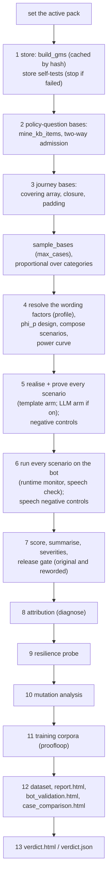

# 8. Campaign: the thirteen steps, end to end

```
voicebot/
├── run_campaign.py         the command line (calls run_campaign)
└── gmsjourney/
    ├── s01_packs/  s02_graph/  s03_knowledge/  s04_cases/  s05_rewording/  s06_bots/  s07_checks/
    ├── s08_campaign/       ◀ this chapter
    │   ├── __init__.py
    │   ├── pipeline.py     CampaignConfig, build_gms, run_campaign (the thirteen steps)
    │   └── outputs.py      failure-mode taxonomy, training corpora, dataset tables
    ├── s09_reports/  s10_console/
    └── policy/
```

## The idea

`s08_campaign/` is the **conductor**: it plays no instrument itself, it calls every segment in the right order and
collects what each produces into one result dictionary `R`. The notebook, the console and `run_campaign.py` all call
the same function:

```python
from gmsjourney.s08_campaign.pipeline import CampaignConfig, run_campaign
R = run_campaign(CampaignConfig(domain="supplementary_card", out_dir="output/sc", max_cases=20))
```

## pipeline.py

```
s08_campaign/
└── pipeline.py   ◀   PART 1 CampaignConfig, build_gms, run_campaign, sample_bases, failed_case_records,
                             speech_section, llm_pool, pick_llm_rows
                      PART 2 run_graph_campaign (the older compact-graph path, kept for its tests)
```

### `CampaignConfig`: every setting in one place

| group | settings (defaults) |
|---|---|
| what to test | `domain` (pack), `policy_path`, `bot_factory` (default: the reference bot), `bot_name`, `out_dir` |
| how much | `profile` (`voice_full`), `runs_per_base` (6), `max_cases` (all), `seed` (42), `kb_questions` (`standard` / `extended`), `max_turn_limit_cases` (2) |
| the customer | `customer` (`scripted`: each case's base journey, line by line, whatever the bot answers; `adaptive`: answers the bot's last question) |
| which checks | `run_mutation`, `run_resilience`, `run_power`, `run_governance` (all on), `speech_gate` (`fail`), `speech_controls`, `negative_controls_per_type` (40), `decision_rule` (`strict` / `quorum`), `budgets`, `calibration_bootstrap` (200) |
| the store | `device`, `rebuild_store`, `kx_store_dir`, `kx_epochs`, `kx_geode_epochs` (300), `kx_geode_max_iters` (8), `kx_embed_trainer_epochs` (150), `kx_embed_max_iters` (2), `kx_sft_epochs`, `kx_contradiction_epochs` (400), `kx_store_config`, `kx_dedup_mode` (`off`), `kx_v_sft_mode` (`full`), `allow_failed_self_tests` |
| the test tools' LLM | `llm_backend` (`gateway` / `local`; None: the environment's choice), `llm_local_path` (the model folder vLLM loads, or the served model's name), `llm_vllm_url` (an OpenAI-compatible vLLM server): one setting for the LLM arm (rewording, dual read, adversary), the case narration, the policy judge and the LLM judges. The bot under test chooses its own model |
| the LLM judges | `llm_judges` (off; on by default in the console), `llm_judges_mode` (`live` / `replay`), `llm_judges_max_runs` (all; failed runs first) |
| the LLM arm | `llm_arm` (off), `llm_mode` (`live` / `replay`), `llm_model`, `llm_temperature` (0.7), `llm_share`, `llm_dual_read` (`gate`), `llm_max_attempts` (3), `llm_adversarial_controls` (20), `llm_workers` (8), `llm_max_scenarios`, `llm_target_accepted`, `llm_asides`, `llm_exclude`, `llm_template_acts`, `llm_turn_fallback` ... |
| reporting | `progress`, `on_step(step, title, R)` (the console's hook), `max_failed_cases_in_report` (400) |

### `run_campaign`: the steps in detail



1. **Store.** `build_gms` returns the trained store, built once per policy and settings, then reloaded from its
   directory (`~/.cache/gmsjourney/stores/<hash>`). For a compiled pack without knowlytix, the symbolic store is used.
   The store self-tests must pass (chapter 3) unless `allow_failed_self_tests`.
2. **Policy-question bases**, each admitted by the two-way check (chapter 3).
3. **Journey bases** by covering array and closure, padded to their turn targets (chapter 4).
   `sample_bases(n)` keeps `max_cases` bases spread over the categories in proportion to their size, so a quick run
   still has every kind of case.
4. **Design.** The catalog profile is resolved for this pack, the space-filling design is built over the selected
   wording factors, and scenarios are composed (embedded: rows dealt to bases); the power curve sets the budget.
5. **Rewording and proof.** Every scenario's turns are realised and proved (chapter 5); rejected scenarios are
   excluded and counted. With `llm_arm`, `llm_pool` selects the design rows the LLM may rewrite (rows with policy
   questions or turn padding stay with the templates, `llm_exclude`), `pick_llm_rows` takes a share of them spread
   over the bases, and the LLM arm proves its own scenarios. Then, before any bot is run, the **answer sheet**
   (`s09_reports/answer_sheet.py`, `out/answer_sheet.html`): every generated case, turn by turn, with what the
   customer says and means, what a correct bot must do (tool calls with key arguments, then its acts), the rules of
   the state and how the call must end, all from the oracle's own run of the case; and under it every reworded version
   (both arms) with its changed factor levels and whether the proof accepted it. The console shows it from step 5 of
   the run page (**Open the answer sheet**).
6. **Bot runs.** Each scenario is played (chapter 6) with the runtime monitor watching and the speech check on every
   turn; the speech negative controls run on the base cases.
7. **Scoring** (chapter 7): accuracy on original and on reworded wording, severities, two release gates (original
   and reworded; showing only the original gate made a bot that fails every reworded case look releasable).
   `failed_case_records` keeps the failed runs (most severe first, transcripts capped) for the report;
   `speech_section` summarises what the bot said across the campaign.
8. **Attribution**, 9. **resilience**, 10. **mutation analysis** (chapter 7).
11. **Training corpora** (below), skipped when proofloop is not installed.
12. **Outputs**: the dataset tables, the reports (chapter 9).
13. **Verdict** (chapter 9).

`on_step(step, title, R)` is called as each step starts, so the console can show progress; every step's results are
in `R` under a fixed key, so a step that was switched off simply reads as skipped.

`run_graph_campaign` (Part 2) is the older path for a compact graph (journeys mined by the interpreter); it is kept
because tests use it.

## outputs.py

```
s08_campaign/
└── outputs.py   ◀   PART 1 coverage (proofloop's failure-mode taxonomy)
                     PART 2 classifier_corpus, goldens_from_store, draft_corpus
                     PART 3 write_dataset (<out_dir>/dataset/)
```

### Part 1: failure-mode coverage

proofloop has a taxonomy of how AI systems fail (hallucination, ignoring a constraint, tool misuse ...). `coverage()`
maps each failure mode onto the probes this campaign runs (which mutants, faults, wording factors and gates exercise
it, and which mutants were killed), so a reader can see which kinds of failure the campaign actually tested.

### Part 2: training data

The proved material is valuable beyond testing:

* `classifier_corpus`: every proved customer turn with its meaning card (kept only when the proof accepted it), as
  training records for an utterance classifier;
* `goldens_from_store`: the contracts a good policy answer must meet (keywords to cite, numbers to state, phrases to
  avoid), read from the store;
* `draft_corpus`: each admitted policy question with a bot's answer, kept when the answer meets its contract.

Both are written through proofloop's emitters (`sft_classifier.jsonl`, `sft_draft.jsonl`).

### Part 3: the dataset tables

`write_dataset(out_dir, ...)` writes the generated suite as plain tables any tool can open: one row per test case
(category, policy question, canonicals, meaning cards, base wording, rewording, expected outcome, the complete expected
trajectory, the proof's verdict), one row per customer turn (state, stage, the state's rules, limits and accepted
cards, the meaning card and its triples, base and reworded text, the read-back card, equivalence), the policy
questions, and the graded results. Every file is listed in chapter 11.
