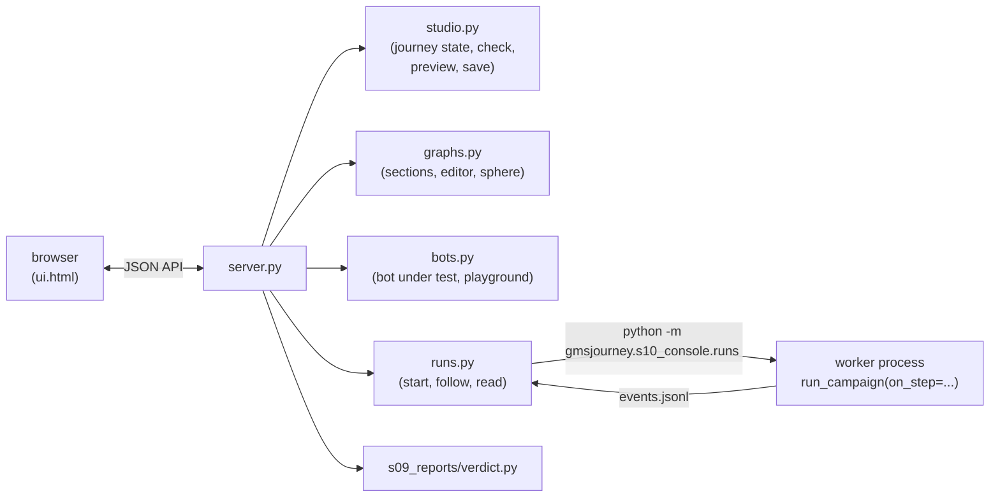

# 10. Console: the local web app

```
voicebot/
├── notebooks/journey_console.ipynb     starts the console from Jupyter
└── gmsjourney/
    ├── s01_packs/  s02_graph/  s03_knowledge/  s04_cases/  s05_rewording/  s06_bots/  s07_checks/  s08_campaign/  s09_reports/
    └── s10_console/          ◀ this chapter
        ├── __init__.py       start / show / stop / running (from Python or Jupyter)
        ├── __main__.py       python -m gmsjourney.s10_console
        ├── server.py         the HTTP server and its JSON API
        ├── studio.py         the project studio: graph view, factor editor, preview, save
        ├── runs.py           campaign runs in their own processes; step summaries; the case explorer; comparing runs
        ├── bots.py           attachments, the bot under test, the playground, saved conversations
        ├── graphs.py         open a graph by path, sections, core segments, editor, the GMS sphere
        ├── ui.html           the console page
        └── studio_ui.html    the standalone studio page
```

## The idea

Everything the notebook does can be done from a browser page: choose a journey by its graph's path, read what the
graph decides, edit what the project configures, run campaigns, read the verdict, and talk to the bot yourself. The
console is a **cockpit** over the same objects the notebook uses; nothing in it is specific to a pack.

```python
from gmsjourney import s10_console as console
console.show()      # start it in a background thread and show it in the notebook
console.stop()      # stop it; runs in progress keep going
```

or `python -m gmsjourney.s10_console --port 8790` from a shell. The page keeps two sources apart everywhere, in colour and
in words: **what the graph decides** (read-only) and **what the project sets** (editable).

**The flow.** The left rail is the route through the work, as five stations on a line: 1 Understand the policy,
2 Set up the tests, 3 Try the bot, 4 Put the bot to test, 5 Read the results. In the console a campaign is called a
*test run*; in code it is still `run_campaign`. A station fills in when its work is done (the
same record as the getting-started steps, kept per journey in the browser), every page names its stage above its
title and ends with a link to the next page, and Overview shows only the next getting-started step (Help lists them
all). Cyan marks what the graph decides, violet what you set; green, amber and red are only ever status.

**Themes.** Day is Prussian blue on white drafting film, night is pale blue on a blue-black cyanotype. Auto follows
the system; the switch in the top bar keeps your choice (`jc.theme` in the browser), the studio page shares it, and
the GMS sphere redraws in the new colours. Fonts are IBM Plex Sans, Sans Condensed (titles) and Mono (graph names),
loaded without blocking the page; offline, the system fonts are used. Colour that is not blue always means something
(the section colours, cyan for the graph, violet for your project, green, amber and red for status), so the top bar
colours only the journey's validity and an active run; the machine and the bot under test are set quietly. Help on a
page (dismissable hints) is drawn dashed, status notices solid. Names from the graph are set in mono and stay on one
line in tables; words, such as filter choices and severities, are set in the text face. One primary button per screen.

**Getting around.** **Go to** in the top bar (or Ctrl/⌘ K anywhere) opens a palette that searches every page, journey,
factor, graph state and recent test run, plus common actions (start a test run, choose the bot, switch theme,
save); arrow keys and Enter jump there. A test run in progress shows
in the browser tab's title (`▶ 7/13 · …`), so it can be followed from another tab; when it finishes, a toast says so,
and if the tab is hidden and the browser allows notifications (asked once, when you start a run) a system
notification does too. Stage 2 of the route rail says *unsaved edits* as soon as the project has changes you have
not saved. On narrower screens the top bar keeps its controls on one line by shortening labels (the full text is in
each control's tooltip).

**Undo.** Every edit to the project can be undone: Ctrl/⌘ Z (Shift for redo, or Ctrl Y), or Undo and Redo in the
unsaved-changes bar. A burst of edits (typing in one field) is one step; up to 100 steps are kept, and Discard is
itself a step, so it can be undone too. Inside a text field the field's own undo handles the typing.

**Opening a graph.** As you type a path in the top bar, a preview under the field says what opening it would do,
without opening anything (`GET /api/graph/peek`): the graph's title, format, size, states, tools and rules, and
whether it opens a journey already here, switches a journey to this version, or makes a new journey. A partial path
or a folder lists the graphs found there; arrow keys move through them and Enter picks one.

**Progress.** Every long part of a test run reports how far it has got (`gmsjourney/progress.py`), and the run page
draws it inside the running step: the knowledge store's training as one segment per phase (compile, GEODE loop,
embed loop, contradiction SFT, relevance, production store, coverage, judge), with the time left in the current phase
estimated from the last store built on the machine and a live count of optimizer steps (training runs inside
knowlytix, so its steps are counted with torch's global optimizer hook); counted loops (cases played, reworded cases
proved, runs under tool faults, planted defects, saved conversations) as a bar with the time left; and every LLM
call of the run as a split of calls answered from the cache, calls to the model and failures, by caller (bot under
test, critique, rewording ...), with the live call rate and tokens. The running step in the list shows a thin bar and
its percentage, as do the top bar's run pill and the tab title. A finished step keeps one line per bar (what was
counted and how long it took).



## \_\_init\_\_.py and \_\_main\_\_.py — starting it

`start(port=8790)` starts the server in a background thread and returns its URL (running it again returns the same
URL); `free_port` takes the next free port when another kernel holds it; `running()` lists the consoles this process
serves; `stop()` stops them. `show()` also works out **where a browser can reach the page**, in this order:

1. on JupyterHub, `<prefix>proxy/<port>/` (jupyter-server-proxy);
2. on any Jupyter server whose `/proxy/<port>/` reaches the console, that path, relative to the Jupyter page, so it
   works wherever the browser is (for example when the kernel runs on a remote GPU machine);
3. otherwise `http://127.0.0.1:<port>/`, with a note on which port to forward.

`GMSJOURNEY_CONSOLE_URL` (with `{port}`) overrides all three (`url_for`). `__main__.py` is the command line
(`--port`, `--host`, `--runs DIR`).

## server.py — the HTTP server

The standard library's threaded HTTP server serves one page (`ui.html`) and a small JSON API (listed at the top of
the file: journeys, project check / preview / save, runs, cases, verdict, the bot's prompt, attachments, the gateway
check, the playground, graph open / sections / edit / check / save / use / sphere). `packs()` lists every journey
under `gmsjourney/policy/`; `make_server(port)` builds the server.

The graph and project calls share **one process-wide active journey** (chapter 1), so they are serialised under a
lock, and every call puts back the journey that was active before it, so the console never leaves the notebook's
kernel on a journey it chose. Campaign runs never happen in the server.

## studio.py — the project studio

`Studio` is one journey's project in the console: the graph's view (states and their transitions, tools and their
statuses, limits, value sets, rules, triggers), what the harness derives from it (the nomenclature, the outcomes and
customer choices the factors cover or miss), and the project's own choices (bank, customer, factors and levels,
constraints, categories, tags). It offers:

* **check as you edit**: every edit is checked against the graph after a short pause, and each problem is shown on
  the factor it belongs to;
* **preview**: for any combination of levels, the oracle walks the graph and the page shows the expected
  conversation. `level_site` says where a level acts (the prompts whose answer it changes, the tools whose answer it
  sets) and `reach` finds the levels of other factors needed to get there, so a preview of "the submit tool declines"
  plays a case that actually reaches the submit;
* **save**: checks the file and writes it, keeping `<file>.bak`; `to_yaml` puts a short note above each section;
  `normalize` undoes what JSON does to level names in the browser.

It runs on the symbolic store compiled from the graph (about a second; no training, no licence) and listens on
127.0.0.1 only. `python -m gmsjourney.s10_console.studio --pack <pack>` serves it alone (`studio_ui.html`).

## runs.py — campaign runs

```
s10_console/
└── runs.py   ◀   PART 1 summarize, headline, done_steps, clean     PART 2 load, index, detail
                  PART 3 Runs, devices, check_device                 PART 4 main (the worker)
```

* **Part 3** `Runs`: each run is a folder `output/console_runs/<id>/` holding `job.json` (the settings), `events.jsonl`
  and the campaign's `out/`. Starting a run launches `python -m gmsjourney.s10_console.runs <run_dir>` as **its own
  process** (one at a time), with the device in `GMSJOURNEY_DEVICE`. The worker is the leader of its own process group,
  so Cancel stops everything the campaign started, and its pid is in the run's first event, so a run started before a
  kernel restart is still found and can still be cancelled. `devices()` lists cpu and every CUDA GPU torch can see;
  `check_device` says why one cannot be used.
* **Part 4** `main`: the worker calls `run_campaign` with an `on_step` hook and appends events (start, step_start,
  step_done with that step's summary, log lines, progress, saved, done with the headline, error). The page polls from
  the last event it has, so a closed tab or a restarted kernel loses nothing. It installs a sink on
  `gmsjourney.progress` that writes every report as a `progress` event (at most two a second per bar, plus each
  phase change and the last report). After the campaign it replays the journey's saved Playground conversations
  against the run's bot (`_replay_saved`): `out/saved_conversations.json`, a `saved` event, and the counts in the
  headline.
* **Comparing runs** `compare(root, a, b)` (`GET /api/runs/compare?a=&b=`; Test runs › Compare, or Compare with the
  previous run on a finished run): the cases both runs played, matched by sid from `results_base_level.csv` and
  `results_enriched.csv`, sorted into now failing (regressions), now passing, still failing and still passing, with
  the failure codes before and after; the headline numbers (also on the shared cases only), both release gates and
  the per-stage scores, before beside after. It says when the runs are not like for like: another journey, another
  graph version (the graph hash each run records), another seed, or cases only one of them played.
* **Part 1** `summarize(step, R)`: what each of the 13 steps produced, as headline metrics, small tables and notes,
  read only from keys the pipeline writes (a step that was switched off reads as skipped; a summary never breaks a
  run). `headline` carries both release gates.
* **Part 2** the case explorer: `load` reads a finished run's cases, proofs and results (cached by file time),
  `index` lists every base case with its reworded versions, `detail` shows one case in full (each version's turns in
  original and reworded words, the meaning read back, the proof's verdict, the bot's result with its turn-by-turn
  comparison).

## bots.py — the bot under test and the playground

```
s10_console/
└── bots.py   ◀   PART 1 extract (attachments)   PART 2 make_factory, suggested, check_gateway
                  PART 3 the playground: Bench, cases, Session, start, get
                  PART 4 saved conversations: save_conversation, saved_list, replay, replay_all
```

* **Part 1** `extract(name, data)`: text from a file a tester attaches to the LLM bot's prompt (text, Markdown, JSON,
  YAML, CSV, PDF, Word, Excel), capped in size.
* **Part 2** `make_factory(job)`: the reference bot (no LLM), or an LLM bot through the gateway or a local model, with the critique layer on by default (`critique_on`) and reviewed by `critic_model` when one is given (else by the bot's own model), from a job's `sut` settings (`settings_for`). The console's **Bot:** switch in the top bar shows which bot is in use for the journey and opens the choice, which the Playground and test runs share. `suggested()` gives the suggested prompt and the fixed protocol the harness adds; `check_gateway` makes one tiny call.
* **Part 3** the **playground**: talk to the bot yourself on one case of any journey. `Bench` holds the journey's
  store, oracle, reader, realizer and speech verifier (built once per journey; `reset` forgets it when the graph
  changes). `cases` offers the cases of the latest finished test run, any test run (`run_cases` rebuilds them
  exactly), or the project's default case and one case per non-default level (`factor_cases`). A `Session` sets the
  mock bank from the case and keeps the case's simulated customer. At every turn the tester picks one of two ways to
  answer (`Session.say(text, mode)`):
  * `journey`: the case's customer answers the bot's last act (the same `UserSimulator` a test run uses, so after a
    bot mistake it still answers what the bot actually asked; `journey_line` previews it without using it up by
    replaying the questions already answered on a fresh simulator);
  * `free`: the typed words, shown next to what the journey's customer would have said and whether it means the same.

  Both are read into a meaning card and validated identically: the oracle replays the cards so far and the bot's
  turn is compared with the graph's (tools with key arguments, decision acts) and speech-checked. Every turn that
  differs is a deviation (`deviations`, the first is `diverged_at`) with its reasons (`why`). Each turn carries its
  answer sheet (`sheet`): the dialog state answered (`_state_sheet`: accepted acts, bare yes/no, rules, limits), the
  card as triples, and the graph transitions of the turn (`_hops`, cut from the oracle's own `flow_path`: a transition
  on a customer act starts a new turn) with condition, rules, triple and source.
* **Part 4** **saved conversations**: *Save as a test case* keeps a conversation's customer lines, in order, with the
  case it started from, a name and a note, in `<pack>/saved_conversations.json` (next to `project.yaml`, so it travels
  with the journey). Only the customer's side is kept: the bot's side is what is tested. `replay(rec, sut)` sends the
  same lines to a bot as `replay` turns and validates each turn exactly as the Playground does; the Playground lists
  the saved conversations and replays any of them with the chosen bot, and every test run replays them all against
  its bot (`replay_all`), so a deviation found by hand is checked on every later bot. A replay passes when every line
  was sent and no turn deviated; a case that no longer exists in the project is reported, not skipped.

## graphs.py — the graph pages

```
s10_console/
└── graphs.py   ◀   PART 1 open_graph, sections, core_segments, the editor
                    PART 2 the GMS sphere
```

### Part 1: open, read, edit

`peek_graph(path)` is what the top bar's preview shows: never raises, says what is wrong with a path, and suggests the
graphs in a folder or matching a partial name.

* `open_graph(path)`: a graph inside a journey folder opens that journey (switched to that file if it is one of its
  versions, `set_graph`); a **compact graph from anywhere else becomes a new journey** (`new_journey`): copied into
  `gmsjourney/policy/<its id>/` with a drafted `domain.yaml` (lexicon and bot lines, chapter 1), the catalog layer
  copied from a template journey, and a drafted `project.yaml`. `check_wording` then plays every project case with
  the reference bot and the speech check and reports any drafted line that fails. `resolve` / `rel` handle typed
  paths.
* `sections()`: every triple of the compiled graph classed into seven sections (`classify`): used by the customer,
  by the bot, by both, defining the flow, rules, knowledge and figures, other. `set_roles` decides who uses each value
  set from how it is used (a customer act carries it, or only tools return or take it); `shared_slots` lists the value
  sets that pass from the customer's words into tool arguments. The Graph sections page draws the split as one strip,
  each section as wide as its share of the triples, with a selector per section (count and share) under it.
* `core_segments()`: the **18 things every graph needs** for the validations a campaign runs (an opening, caller
  verification and its attempt limit, customer acts with worded values, prompts, tools with success and failure
  results, confirmation before acting, an echo check, justified handoffs, asking for a person, unclear answers, a turn
  limit, policy questions, rules each checked somewhere, figures with units, reachability, the bot's wording, the
  customer's wording), each with what it is needed for and what is missing. The list is in a fixed order.
* the **editor**: `editable()` gives the graph's own entries (for a compact graph one entry per value set, act, tool,
  state, rule and limit, `compact_items`; for a triples graph one row per triple); `apply_items` / `build_doc` turn the
  edits back into a document; `check_candidate` lints it in a scratch copy of the journey folder; `diff` lists what
  changed; `save_version` writes `<name>.vN.json` beside the original and switches the journey to it (only
  `domain.yaml`'s `graph:` line changes; the original file is never written); `versions` lists them.

### Part 2: the GMS sphere

On the page the sphere turns slowly on its own (paused while you hover, select or drag; off under reduced motion),
keeps the momentum of a drag, and turns to face whatever you select. Selecting a relation (side list, menu, or a click
on an arc, found from points sampled along the drawn arcs) draws its arcs with a flowing dash and an arrowhead in the
relation's direction and fades the rest; the panel shows the relation's meaning (`relation_docs`, from the graph's
relation table), its counts, section, pattern (entity type to entity type), the relations that share its entities
(ranked by how many) and every triple with its id, source and evidence. Turning to face a selection is a small
calculation: with `c` the normalised mean of the selected points, the yaw `a = atan2(-c.x, c.z)` brings `c` into the
y-z plane and the pitch `b = atan2(c.y, sqrt(c.x² + c.z²))` then brings it to the front; the view eases towards
`(a, b)` the short way round.

**Spread and full view.** A spectral layout tends to bunch points on one side of the sphere, so the page relaxes it
before drawing: a few hundred steps of pairwise repulsion (force ∝ 1/d²) with a pull along each relation, moving
points along the sphere's surface. The **Spread** slider blends between the computed placement (0) and the relaxed
one (1); the default is 0.85 for a graph-only layout and 0 for a layout from the learned store, whose positions mean
something. The text beside it gives, for what is drawn, the mean arc between linked entities against random pairs,
so you can see that spreading keeps neighbours close. **Full view** hides the rail and page text and gives the
sphere the whole window; Esc (with nothing selected) or Leave full view goes back.

`build()` places every entity of the graph as a point on the unit sphere and every relation as a great-circle arc,
coloured by section:

* when a campaign has trained this journey's store, from the store's learned entity vectors (`store_vectors` reads
  `v_emb.pt`; `pca_sphere` takes their first three principal components and normalises them onto the sphere);
* otherwise from the graph alone (`spectral_sphere`): build the adjacency matrix `A` and the normalised Laplacian
  `L = I − D^(-1/2) A D^(-1/2)`; its 2nd–4th eigenvectors give each entity three coordinates in which linked entities
  are close (the first eigenvector is trivial); normalise onto the sphere, then refine by a few hundred steps where
  linked entities attract and every pair repels. It is deterministic, so the picture is the same every time.

Analogy: arranging people on a globe so friends stand near each other; the eigenvectors give a good first
arrangement, and the refinement nudges everyone until the crowd settles. The page states how close linked entities
sit compared with random pairs, a direct check that the picture means something.
