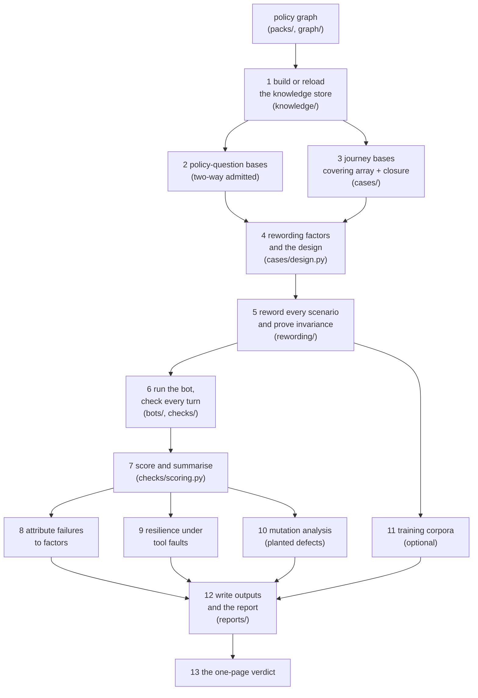
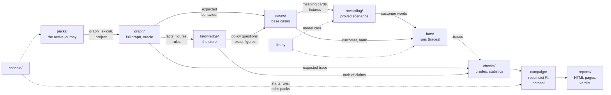

# The gmsjourney guide

This guide explains the whole project: what it does, why it is built this way, every algorithm it uses, every kind
of data it reads and writes, and every file in the repository. It is written for someone who has never seen the
code. Each chapter covers one folder (a *segment*) and starts with a picture of the repository showing where that
folder sits.

## Contents

| # | chapter | the segment's job, in one line |
|---|---|---|
| 0 | [this page](README.md) | the big picture, the thirteen steps, the whole repository map, a glossary |
| 1 | [Packs](01-packs.md) | load a journey's files and check that they agree with each other |
| 2 | [The policy graph](02-graph.md) | the policy as data, its two formats, the compiler, and the oracle that walks it |
| 3 | [Knowledge](03-knowledge.md) | the knowledge store: exact figures, the trained geometry, policy-question answers |
| 4 | [Cases](04-cases.md) | what a test case is, the simulated customer, and how few cases still cover everything |
| 5 | [Rewording](05-rewording.md) | saying the same thing in other words, and proving the meaning did not change |
| 6 | [Bots](06-bots.md) | the bots under test, the mock bank, and the harness that plays a conversation |
| 7 | [Checks](07-checks.md) | grading a run: outcome, words, runtime gates, statistics of why it failed |
| 8 | [Campaign](08-campaign.md) | the thirteen steps end to end, and the tables and corpora they write |
| 9 | [Reports](09-reports.md) | the HTML report, case-by-case pages and the one-page verdict |
| 10 | [Console](10-console.md) | the local web app: edit a journey, run campaigns, talk to the bot |
| 11 | [Data formats](11-data.md) | the pack files, the catalogs, every output file |
| 12 | [Around the package](12-repository.md) | `llm.py`, tests, tools, notebooks, and the files at the root |

If you only read one other page, read chapter 2: the policy graph is the source of everything else.

## What the project does, in one paragraph

A company writes down how its voice bot must behave (the *operating procedure*: authenticate the caller, present
each charge, record whether the caller recognises it, never call a charge fraud, transfer after two failed
attempts...). `gmsjourney` turns that document into a machine-readable *policy graph*, generates hundreds of test
conversations from it, computes the correct behaviour for each one **by walking the graph** (never by a person
writing the answer down), rewords each customer line many ways while **proving** the meaning stayed the same, plays
every conversation against the bot under test, grades what the bot did *and* what it said, explains statistically
which conditions make it fail, checks that the test suite itself can catch planted defects, and ends with a
one-page release verdict.

## An analogy for the whole thing

Think of a **driving test centre**.

* The **highway code** is the policy document. The centre writes it out as a precise rule book that a machine can
  follow (the *policy graph*).
* The **examiner** knows, for any situation on the road, exactly what a good driver does next, because they follow
  the rule book (the *oracle*).
* The **test routes** are chosen so that every important manoeuvre and every pair of conditions (rain *and* a
  roundabout, night *and* a school zone) comes up at least once, without driving every road in the country
  (the *covering array* and the *space-filling design*).
* The **other road users** behave the same way on every test of a route, but can be described in different words:
  a learner who is told "the car ahead brakes" or "the vehicle in front slows sharply" faces the same event. Before
  a reworded route is used, someone proves that it is still the same route (the *invariance proof*).
* The **candidate** is the bot under test.
* The **marking sheet** records not only where the car went but also what the driver said to the passenger (the
  *speech check*), with severities: running a red light fails you outright, a wide turn costs a point.
* After many tests the centre asks **why** candidates fail: rain? night? the long routes? (*attribution*). And it
  tests its own examiners by sending in drivers with one known bad habit each, to see whether the test catches
  them (*mutation analysis*).
* The **result letter** says pass or fail, the three biggest risks, and how anyone can repeat the test (the
  *verdict*).

## The thirteen steps of a campaign

`run_campaign(CampaignConfig(...))` (in `gmsjourney/campaign/pipeline.py`) runs these steps. The notebook, the
console and `run_campaign.py` all call it.



| step | what happens | where |
|---|---|---|
| 1 | the policy is compiled into the symbolic store; with knowlytix installed the geometric store is trained (or reloaded from its cache) and calibrated | `knowledge/build.py` |
| 2 | policy questions ("how much is expedited delivery?") are generated in 18 categories; each is admitted only when the exact answer and the geometric recovery agree | `knowledge/questions.py` |
| 3 | journeys (whole conversations) are generated: every feasible pair of factor levels in some case, then extra cases until every rule, transition, transfer reason and boundary is reached | `cases/design.py`, `cases/factors.py` |
| 4 | the wording factors (style, noise, numbers spoken or as digits ...) are chosen from the catalogs and laid out by a space-filling design | `rewording/catalog.py`, `cases/design.py` |
| 5 | every customer turn of every scenario is written under its wording levels (templates, optionally an LLM), read back, and the scenario is proved to be the same test as its base | `rewording/` |
| 6 | each scenario is played against the bot: the simulated customer answers, the mock bank serves tools, every bot turn is checked as it happens | `bots/harness.py`, `checks/` |
| 7 | each run is scored against the oracle (outcome, stages, trajectory, words) and summarised; severities and the release gate | `checks/scoring.py` |
| 8 | logistic models and likelihood-ratio tests find which factor levels raise the failure rate | `checks/diagnosis.py` |
| 9 | tool faults (error, timeout, stale data, plausible wrong answer) are injected: does the bot fail loud? | `checks/diagnosis.py`, `bots/tools.py` |
| 10 | defects are planted in the reference bot one at a time: does the suite catch them? | `checks/diagnosis.py`, `bots/reference.py` |
| 11 | proved utterances and graded answers become training data | `campaign/outputs.py` |
| 12 | dataset tables, the HTML report, the bot-validation page, the case comparison | `campaign/outputs.py`, `reports/` |
| 13 | the verdict: release or not, top risks, the run's fingerprint, every case expected beside actual | `reports/verdict.py` |

## How the pieces hand work to each other

The diagram follows the data: each arrow is "produces something the next one reads". (The code itself imports
across folders where it needs to; the top-level imports between modules form no cycle, so every module loads on
its own.)



## The repository, file by file

Every file of the project, with the chapter that explains it. Folders that hold only generated files (`output/`,
`__pycache__/`) are left out.

```
voicebot/
├── README.md                    quick start, results, layout                                   ch. 12
├── DESIGN.md                    design notes: every decision and its reason                     ch. 12
├── NOTICE                       licences of the libraries used                                  ch. 12
├── pyproject.toml               the package definition                                          ch. 12
├── requirements.txt             Python dependencies                                             ch. 12
├── requirements-llm.txt         extra dependencies for the local LLM bot                        ch. 12
├── run_campaign.py              command line: run a campaign                                    ch. 12
├── gmsjourney/
│   ├── __init__.py              the package overview
│   ├── llm.py                   the model-gateway client with its replay cache                  ch. 12
│   ├── packs/                                                                                   ch. 1
│   │   ├── __init__.py
│   │   ├── loading.py           load a pack, make it active, lint it against its graph
│   │   ├── names.py             every name the graph defines (N.state.X), tools by role
│   │   ├── project.py           project.yaml: mock bank, customer, factors, scoring settings
│   │   └── drafting.py          drafts of lexicon, bot lines and project.yaml from a graph
│   ├── graph/                                                                                   ch. 2
│   │   ├── __init__.py
│   │   ├── triples.py           the full graph (head/relation/tail), built from the PDF; PolicyKG
│   │   ├── compact.py           the compact graph format (a state machine in one JSON file)
│   │   ├── compile.py           compact graph -> full graph and symbolic store
│   │   ├── flow.py              the expression language and the oracle that walks the graph
│   │   └── interpreter.py       the compact graph's own walker (mining, compiler check)
│   ├── knowledge/                                                                               ch. 3
│   │   ├── __init__.py
│   │   ├── store.py             ingest, the symbolic store (exact figures), canonicals, GEODE view
│   │   ├── build.py             self-correction, the knowlytix backend, the trained store
│   │   └── questions.py         true answers to policy questions, grading, question mining
│   ├── cases/                                                                                   ch. 4
│   │   ├── __init__.py
│   │   ├── meaning.py           meaning cards (semantic frames) and the ontology
│   │   ├── journey.py           one case's levels, relevance, the bank fixture, the customer
│   │   ├── factors.py           journeys and factors mined from a compact graph
│   │   └── design.py            covering arrays and space-filling designs
│   ├── rewording/                                                                               ch. 5
│   │   ├── __init__.py
│   │   ├── catalog.py           records (QAItem, Scenario) and the factor catalogs
│   │   ├── wording.py           lexicon, noise, the realizer, the frame reader
│   │   ├── proof.py             the invariance proof and negative controls
│   │   ├── llm_arm.py           the LLM writes turns: prompts, realizer, second reader, gates
│   │   ├── llm_pack.py          the LLM arm's wording read from any pack
│   │   ├── llm_proof.py         the LLM arm's proof; build_llm_arm
│   │   └── catalogs/official/   the domain-neutral factor and base catalogs (data)          ch. 11
│   ├── bots/                                                                                    ch. 6
│   │   ├── __init__.py
│   │   ├── tools.py             the mock bank, fault injection, the Trace of a run
│   │   ├── reference.py         the reference bots and their planted defects (mutants)
│   │   ├── llm_bot.py           an LLM bot (gateway or local model) with a critique layer
│   │   └── harness.py           plays a case against a bot; adapters for your bot
│   ├── checks/                                                                                  ch. 7
│   │   ├── __init__.py
│   │   ├── scoring.py           correctness, severities, risk tiers, the release gate
│   │   ├── speech_reading.py    what the bot said: contract, session facts, reader
│   │   ├── speech_checks.py     every spoken claim against its source
│   │   ├── speech_policy.py     policy statements in the words; negative controls for speech
│   │   ├── runtime.py           the runtime monitor that would run beside the bot
│   │   ├── gates.py             the runtime gates and their calibration
│   │   └── diagnosis.py         statistics, attribution, mutation, resilience, bot validation
│   ├── campaign/                                                                                ch. 8
│   │   ├── __init__.py
│   │   ├── pipeline.py          CampaignConfig, run_campaign: the thirteen steps
│   │   └── outputs.py           failure-mode taxonomy, training corpora, dataset tables
│   ├── reports/                                                                                 ch. 9
│   │   ├── __init__.py
│   │   ├── report.py            report.html
│   │   ├── cases.py             narration, turn by turn, case_comparison.html, show_case
│   │   └── verdict.py           verdict.html / verdict.json
│   ├── console/                                                                                 ch. 10
│   │   ├── __init__.py          start / show / stop the console from Python
│   │   ├── __main__.py          python -m gmsjourney.console
│   │   ├── server.py            the HTTP server and JSON API
│   │   ├── studio.py            the project studio (graph view, factor editor, preview)
│   │   ├── runs.py              campaign runs in their own processes; step summaries
│   │   ├── bots.py              attachments, the bot under test, the playground
│   │   ├── graphs.py            graph sections, core segments, editor, the GMS sphere
│   │   ├── ui.html              the console page
│   │   └── studio_ui.html       the standalone studio page
│   └── policy/                  the journey packs (data)                                        ch. 11
│       ├── charge_review/       the reference journey, built from the PDF
│       ├── charge_review_graph/ the same journey written as a compact graph
│       └── supplementary_card/  a second journey (adding a card holder)
├── tests/                       17 test files and 4 helpers                                     ch. 12
├── tools/                       documentation builders and diagnostics                          ch. 12
├── notebooks/                   charge_journey_campaign.ipynb, journey_console.ipynb            ch. 12
└── docs/                        this guide and generated walkthroughs                           ch. 12
```

## How to read a merged file

Most files hold several closely related pieces, called *parts*. A part starts with a banner comment:

```python
# PART 2 - The policy oracle: expected behaviour, computed rather than annotated (Ch. 12.4).
```

The file's docstring (the text at the very top) lists its parts with one line each, so the top of any file is a
table of contents. Every public class and function has a docstring saying what it is for. "Book Ch. n" in a banner
refers to the chapter of *Beyond Ship and Pray* (the testing method this project implements) that the part follows.

## Glossary

| term | meaning |
|---|---|
| **pack** | one journey's folder under `gmsjourney/policy/`: policy graph, `domain.yaml`, `project.yaml`, catalogs |
| **policy graph** | the operating procedure as data: states, acts, tools, rules, limits, transitions |
| **compact graph** | a short way to write a policy graph, as a state machine (schema `gmsjourney.policy_graph/2`) |
| **triple** | one fact `(head, relation, tail)`, e.g. `(expedited, has_fee_usd, 15)` |
| **state** | a point in the conversation where the bot does or asks one thing (`PRESENT_TXN`, `ASK_DISPOSITION`) |
| **act** | what a turn *means*: a customer act (`PROVIDE_CREDENTIAL`) or a bot act (`CONFIRM_RECORDED`) |
| **meaning card / frame** | an act with its slot values: `REPORT_DISPOSITION(disposition=UNRECOGNIZED)` |
| **oracle** | the code that computes the correct behaviour by walking the graph |
| **GMS** | geometric memory store: the knowledge store (exact figures plus trained vectors) |
| **ENM** | exact numeric memory: every authoritative figure, keyed, hashed, never parsed from text |
| **base case** | one test case before rewording: a journey or a policy question with its computed truth |
| **factor / level** | a dimension that varies (e.g. `noise`) and one of its values (`typo`) |
| **journey factor** | a factor that changes what the bot must do (the bank's answer, the customer's choice) |
| **wording factor** | a factor that changes only how the customer says it (style, typos) |
| **scenario** | a base case under one assignment of wording levels |
| **realizer** | writes a customer line from a meaning card under wording levels |
| **frame reader** | reads a customer line back into a meaning card |
| **invariance proof** | the check that a reworded scenario is the same test as its base |
| **negative control** | a deliberate meaning-changing edit the checker must catch (proves the checker works) |
| **SUT** | system under test: the bot being tested |
| **reference bot** | a bot built to follow the policy, used to validate the suite |
| **mutant** | the reference bot with one planted defect |
| **trace** | the record of one run: tools called, acts said, turns, outcome |
| **fixture** | what the mock bank returns in one case |
| **release gate** | thresholds per risk tier that decide whether a bot may be released |
| **campaign** | one complete run of the thirteen steps |
